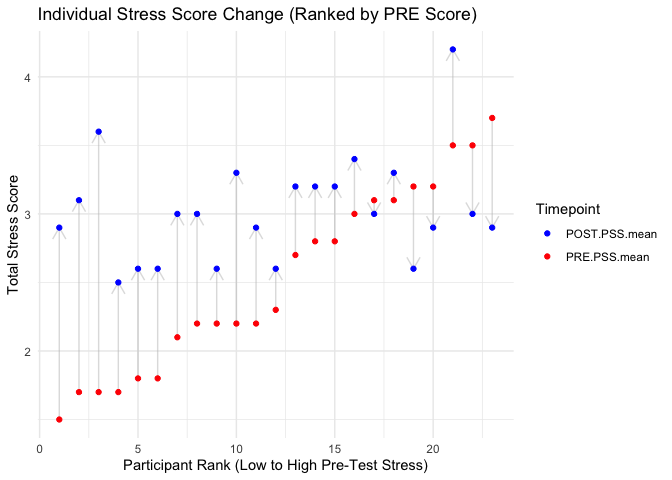
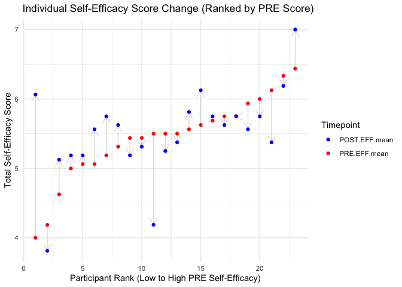

\_02_Analytical_Tests_Finalized
================
ACT
2026-10-28

# 0. Setup & Data Ingestion

## 0.1 Libraries

``` r
library(dplyr)       # Data manipulation
library(stringr)     # String manipulation
library(tidyr)       # Data pivoting
library(readr)       # Reading data
library(kableExtra)  # HTML Table formatting
library(ggplot2)     # Visualizations
library(ggpubr)      # Publication-ready plots
library(rstatix)     # T-tests and effect sizes
library(broom)       # Tidy statistical outputs
library(forcats)     # Factor manipulation
library(effectsize)  # effect size & omega squared
```

# Data From Ingestion - Load & Analyze

- **Reiterating Scales Info**
  - Stress Scale: **PSS** - *Perceived Stress Scale* - 10 Questions
    - Scoring: PSS scores are obtained by reversing responses (e.g., 0 =
      4, 1 = 3, 2 = 2, 3 = 1 & 4 = 0) to the four positively stated
      items (items 4, 5, 7, & 8) and then summing across all scale
      items. A short 4 item scale can be made from questions 2, 4, 5 and
      10 of the PSS 10 item scale.
  - SEFF Scale: **EFF** - *Eearly Intervention Parent Self Efficacy* -
    16 Questions
    - **Scoring Guidelines (Guimond et al., 2008):**
      - Mean/Total scores are computed by aggregating all items of the
        specific scale.
      - Reverse Scored Items: 3, 5, 6, 8, 10, 12, 13, 15, 16.
      - Parent Outcome Expectations: 3, 4, 5, 6, 7, 8, 10, 12, 15, 16.
      - Parent Competence: 1, 2, 9, 14.

# 1. Load Ingested Tables Files

``` r
load(file = "../_output/Analytic_Tables_Finalize_2026-10.Rdata", verbose = TRUE)
```

    ## Loading objects:
    ##   CCMHC_Study_Data_Finalized
    ##   CCMHC_Study_Scores_Finalized

## Include Only Complete Cases

``` r
# Data screening and complete-case flag
CCMHC_Study_Scores_Finalized <- CCMHC_Study_Scores_Finalized |> 
  mutate(Complete_Case = !is.na(POST.PSS.sum) & !is.na(POST.EFF.sum))

table(CCMHC_Study_Scores_Finalized$Group_Assignment, CCMHC_Study_Scores_Finalized$Complete_Case)
```

    ##               
    ##                FALSE TRUE
    ##   Control          2    5
    ##   Intervention     1   23

## Make Specific Analytic Tables

``` r
CCMHC_Study_Scores_Finalized <- CCMHC_Study_Scores_Finalized |> filter(Complete_Case==TRUE)


PSS <- CCMHC_Study_Scores_Finalized |> select(Study_ID, Group_Assignment, contains("PSS"))
EFF <- CCMHC_Study_Scores_Finalized |> select(Study_ID, Group_Assignment, contains("EFF"))
```

``` r
library(tableone)
study.t1.pre <- 
  CCMHC_Study_Scores_Finalized %>% 
tableone::CreateTableOne(
  vars = c("PRE.PSS.sum", "PRE.PSS.mean", "PRE.EFF.sum", "PRE.EFF.mean"),
  strata = "Group_Assignment",
  factorVars = c("Group_Assignment"),
  testNormal = "oneway.test"
) 
study.t1.pre %>%   print(showAllLevels = TRUE, quote = FALSE, noSpaces = TRUE) %>% 
  kable(caption="Study - Pre-Test Descriptive Table") %>% 
  kable_styling(bootstrap_options = c("striped", "hover"), full_width = F) %>%    scroll_box(height = "400px", width = "100%")
```

    ##                           Stratified by Group_Assignment
    ##                            level Control      Intervention  p     test
    ##   n                              5            23                      
    ##   PRE.PSS.sum (mean (SD))        23.80 (9.07) 25.22 (6.76)  0.692     
    ##   PRE.PSS.mean (mean (SD))       2.38 (0.91)  2.52 (0.68)   0.692     
    ##   PRE.EFF.sum (mean (SD))        90.00 (9.54) 81.13 (22.13) 0.393     
    ##   PRE.EFF.mean (mean (SD))       5.62 (0.60)  5.44 (0.60)   0.530

<div style="border: 1px solid #ddd; padding: 0px; overflow-y: scroll; height:400px; overflow-x: scroll; width:100%; ">

<table class="table table-striped table-hover" style="color: black; width: auto !important; margin-left: auto; margin-right: auto;">

<caption>

Study - Pre-Test Descriptive Table
</caption>

<thead>

<tr>

<th style="text-align:left;position: sticky; top:0; background-color: #FFFFFF;">

</th>

<th style="text-align:left;position: sticky; top:0; background-color: #FFFFFF;">

level
</th>

<th style="text-align:left;position: sticky; top:0; background-color: #FFFFFF;">

Control
</th>

<th style="text-align:left;position: sticky; top:0; background-color: #FFFFFF;">

Intervention
</th>

<th style="text-align:left;position: sticky; top:0; background-color: #FFFFFF;">

p
</th>

<th style="text-align:left;position: sticky; top:0; background-color: #FFFFFF;">

test
</th>

</tr>

</thead>

<tbody>

<tr>

<td style="text-align:left;">

n
</td>

<td style="text-align:left;">

</td>

<td style="text-align:left;">

5
</td>

<td style="text-align:left;">

23
</td>

<td style="text-align:left;">

</td>

<td style="text-align:left;">

</td>

</tr>

<tr>

<td style="text-align:left;">

PRE.PSS.sum (mean (SD))
</td>

<td style="text-align:left;">

</td>

<td style="text-align:left;">

23.80 (9.07)
</td>

<td style="text-align:left;">

25.22 (6.76)
</td>

<td style="text-align:left;">

0.692
</td>

<td style="text-align:left;">

</td>

</tr>

<tr>

<td style="text-align:left;">

PRE.PSS.mean (mean (SD))
</td>

<td style="text-align:left;">

</td>

<td style="text-align:left;">

2.38 (0.91)
</td>

<td style="text-align:left;">

2.52 (0.68)
</td>

<td style="text-align:left;">

0.692
</td>

<td style="text-align:left;">

</td>

</tr>

<tr>

<td style="text-align:left;">

PRE.EFF.sum (mean (SD))
</td>

<td style="text-align:left;">

</td>

<td style="text-align:left;">

90.00 (9.54)
</td>

<td style="text-align:left;">

81.13 (22.13)
</td>

<td style="text-align:left;">

0.393
</td>

<td style="text-align:left;">

</td>

</tr>

<tr>

<td style="text-align:left;">

PRE.EFF.mean (mean (SD))
</td>

<td style="text-align:left;">

</td>

<td style="text-align:left;">

5.62 (0.60)
</td>

<td style="text-align:left;">

5.44 (0.60)
</td>

<td style="text-align:left;">

0.530
</td>

<td style="text-align:left;">

</td>

</tr>

</tbody>

</table>

</div>

**Pre-Test Table** - Each Table Shows the respective *scale* **mean**,
(**SD**) and *p*-value for Normality.

``` r
study.t1.post <- 
  CCMHC_Study_Scores_Finalized %>% 
tableone::CreateTableOne(
  vars = c("POST.PSS.sum", "POST.PSS.mean", "POST.EFF.sum", "POST.EFF.mean"),
  strata = "Group_Assignment",
  factorVars = c("Group_Assignment"),
  testNormal = "oneway.test"
) 
study.t1.post %>%   print(showAllLevels = TRUE, quote = FALSE, noSpaces = TRUE) %>% 
  kable(caption="Study - Post-Test Descriptive Table") %>% 
  kable_styling(bootstrap_options = c("striped", "hover"), full_width = F) %>%    scroll_box(height = "400px", width = "100%")
```

    ##                            Stratified by Group_Assignment
    ##                             level Control      Intervention  p     test
    ##   n                               5            23                      
    ##   POST.PSS.sum (mean (SD))        30.80 (1.10) 30.26 (3.90)  0.765     
    ##   POST.PSS.mean (mean (SD))       3.08 (0.11)  3.03 (0.39)   0.765     
    ##   POST.EFF.sum (mean (SD))        87.00 (9.41) 88.04 (10.20) 0.836     
    ##   POST.EFF.mean (mean (SD))       5.44 (0.59)  5.50 (0.64)   0.836

<div style="border: 1px solid #ddd; padding: 0px; overflow-y: scroll; height:400px; overflow-x: scroll; width:100%; ">

<table class="table table-striped table-hover" style="color: black; width: auto !important; margin-left: auto; margin-right: auto;">

<caption>

Study - Post-Test Descriptive Table
</caption>

<thead>

<tr>

<th style="text-align:left;position: sticky; top:0; background-color: #FFFFFF;">

</th>

<th style="text-align:left;position: sticky; top:0; background-color: #FFFFFF;">

level
</th>

<th style="text-align:left;position: sticky; top:0; background-color: #FFFFFF;">

Control
</th>

<th style="text-align:left;position: sticky; top:0; background-color: #FFFFFF;">

Intervention
</th>

<th style="text-align:left;position: sticky; top:0; background-color: #FFFFFF;">

p
</th>

<th style="text-align:left;position: sticky; top:0; background-color: #FFFFFF;">

test
</th>

</tr>

</thead>

<tbody>

<tr>

<td style="text-align:left;">

n
</td>

<td style="text-align:left;">

</td>

<td style="text-align:left;">

5
</td>

<td style="text-align:left;">

23
</td>

<td style="text-align:left;">

</td>

<td style="text-align:left;">

</td>

</tr>

<tr>

<td style="text-align:left;">

POST.PSS.sum (mean (SD))
</td>

<td style="text-align:left;">

</td>

<td style="text-align:left;">

30.80 (1.10)
</td>

<td style="text-align:left;">

30.26 (3.90)
</td>

<td style="text-align:left;">

0.765
</td>

<td style="text-align:left;">

</td>

</tr>

<tr>

<td style="text-align:left;">

POST.PSS.mean (mean (SD))
</td>

<td style="text-align:left;">

</td>

<td style="text-align:left;">

3.08 (0.11)
</td>

<td style="text-align:left;">

3.03 (0.39)
</td>

<td style="text-align:left;">

0.765
</td>

<td style="text-align:left;">

</td>

</tr>

<tr>

<td style="text-align:left;">

POST.EFF.sum (mean (SD))
</td>

<td style="text-align:left;">

</td>

<td style="text-align:left;">

87.00 (9.41)
</td>

<td style="text-align:left;">

88.04 (10.20)
</td>

<td style="text-align:left;">

0.836
</td>

<td style="text-align:left;">

</td>

</tr>

<tr>

<td style="text-align:left;">

POST.EFF.mean (mean (SD))
</td>

<td style="text-align:left;">

</td>

<td style="text-align:left;">

5.44 (0.59)
</td>

<td style="text-align:left;">

5.50 (0.64)
</td>

<td style="text-align:left;">

0.836
</td>

<td style="text-align:left;">

</td>

</tr>

</tbody>

</table>

</div>

# PROMIS-10 Analysis

``` r
# Chunk 4: PSS Change Score Calculation & Descriptive Verification
# Compute absolute change (Post - Pre) and percentage change
PSS_analytic <- PSS |> 
  mutate(
    Group_Assignment = factor(Group_Assignment),
    PSS_sum_change   = POST.PSS.sum - PRE.PSS.sum,
    PSS_mean_change  = POST.PSS.mean - PRE.PSS.mean
  )

# Change-score descriptive table stratified by group
study.t1.change <- PSS_analytic |> 
  CreateTableOne(
    vars = c("PSS_sum_change", "PSS_mean_change"),
    strata = "Group_Assignment",
    testNormal = "oneway.test"
  )

study.t1.change |> 
  print(showAllLevels = TRUE, quote = FALSE, noSpaces = TRUE) |> 
  kable(caption = "PSS - Change Score Descriptive Table (Post - Pre)") |> 
  kable_styling(bootstrap_options = c("striped", "hover"), full_width = FALSE)
```

    ##                              Stratified by Group_Assignment
    ##                               level Control     Intervention p     test
    ##   n                                 5           23                     
    ##   PSS_sum_change (mean (SD))        7.00 (8.34) 5.04 (6.61)  0.571     
    ##   PSS_mean_change (mean (SD))       0.70 (0.83) 0.50 (0.66)  0.571

<table class="table table-striped table-hover" style="color: black; width: auto !important; margin-left: auto; margin-right: auto;">

<caption>

PSS - Change Score Descriptive Table (Post - Pre)
</caption>

<thead>

<tr>

<th style="text-align:left;">

</th>

<th style="text-align:left;">

level
</th>

<th style="text-align:left;">

Control
</th>

<th style="text-align:left;">

Intervention
</th>

<th style="text-align:left;">

p
</th>

<th style="text-align:left;">

test
</th>

</tr>

</thead>

<tbody>

<tr>

<td style="text-align:left;">

n
</td>

<td style="text-align:left;">

</td>

<td style="text-align:left;">

5
</td>

<td style="text-align:left;">

23
</td>

<td style="text-align:left;">

</td>

<td style="text-align:left;">

</td>

</tr>

<tr>

<td style="text-align:left;">

PSS_sum_change (mean (SD))
</td>

<td style="text-align:left;">

</td>

<td style="text-align:left;">

7.00 (8.34)
</td>

<td style="text-align:left;">

5.04 (6.61)
</td>

<td style="text-align:left;">

0.571
</td>

<td style="text-align:left;">

</td>

</tr>

<tr>

<td style="text-align:left;">

PSS_mean_change (mean (SD))
</td>

<td style="text-align:left;">

</td>

<td style="text-align:left;">

0.70 (0.83)
</td>

<td style="text-align:left;">

0.50 (0.66)
</td>

<td style="text-align:left;">

0.571
</td>

<td style="text-align:left;">

</td>

</tr>

</tbody>

</table>

``` r
## -----------------------------------------------------------------------------
# Chunk 5: Within-Group Verification (Paired t-tests by Group)
## -----------------------------------------------------------------------------
# Reshape PSS to long format for paired testing and mixed modeling
PSS_long <- PSS_analytic |> 
  pivot_longer(cols = c(PRE.PSS.mean, POST.PSS.mean), names_to = "Time", values_to = "PSS_mean") |> 
  mutate(Time = factor(if_else(str_detect(Time, "PRE"), "Pre", "Post"), levels = c("Post", "Pre")))

# Paired t-tests per condition
pss_paired_tests <- PSS_long |> 
  group_by(Group_Assignment) |> 
  t_test(PSS_mean ~ Time, paired = TRUE, detailed = TRUE) |> 
  add_significance()

pss_paired_tests |> 
  select(Group_Assignment, estimate, conf.low, conf.high, statistic, df, p, p.signif) |> 
  kable(caption = "PSS mean Score - Within-Group Paired t-Tests") |> 
  kable_styling(bootstrap_options = c("striped", "hover"), full_width = FALSE)
```

<table class="table table-striped table-hover" style="color: black; width: auto !important; margin-left: auto; margin-right: auto;">

<caption>

PSS mean Score - Within-Group Paired t-Tests
</caption>

<thead>

<tr>

<th style="text-align:left;">

Group_Assignment
</th>

<th style="text-align:right;">

estimate
</th>

<th style="text-align:right;">

conf.low
</th>

<th style="text-align:right;">

conf.high
</th>

<th style="text-align:right;">

statistic
</th>

<th style="text-align:right;">

df
</th>

<th style="text-align:right;">

p
</th>

<th style="text-align:left;">

p.signif
</th>

</tr>

</thead>

<tbody>

<tr>

<td style="text-align:left;">

Control
</td>

<td style="text-align:right;">

0.700
</td>

<td style="text-align:right;">

-0.335
</td>

<td style="text-align:right;">

1.74
</td>

<td style="text-align:right;">

1.88
</td>

<td style="text-align:right;">

4
</td>

<td style="text-align:right;">

0.134
</td>

<td style="text-align:left;">

ns
</td>

</tr>

<tr>

<td style="text-align:left;">

Intervention
</td>

<td style="text-align:right;">

0.504
</td>

<td style="text-align:right;">

0.219
</td>

<td style="text-align:right;">

0.79
</td>

<td style="text-align:right;">

3.66
</td>

<td style="text-align:right;">

22
</td>

<td style="text-align:right;">

0.001
</td>

<td style="text-align:left;">

\*\*
</td>

</tr>

</tbody>

</table>

- Paired t-test is significant for **Intervention Group** - no change
  for Control group.

# Chunk 6: Between-Group Models (ANCOVA & Linear Mixed-Effects Model)

``` r
library(lme4)
# Model 1: ANCOVA (Predicting Post score controlling for Baseline)
fit_ancova <- lm(POST.PSS.mean ~ PRE.PSS.mean + Group_Assignment, data = PSS_analytic)

# Model 2: Repeated Measures Linear Mixed-Effects (Group x Time interaction)
fit_lmm <- lmer(PSS_mean ~ Group_Assignment * Time + (1 | Study_ID), data = PSS_long)

# meanmary Outputs
anova(fit_ancova) |> 
  broom::tidy() |> 
  kable(caption = "PSS mean - ANCOVA Model meanmary (Controlling for Pre-Score)") |> 
  kable_styling(bootstrap_options = c("striped", "hover"), full_width = FALSE)
```

<table class="table table-striped table-hover" style="color: black; width: auto !important; margin-left: auto; margin-right: auto;">

<caption>

PSS mean - ANCOVA Model meanmary (Controlling for Pre-Score)
</caption>

<thead>

<tr>

<th style="text-align:left;">

term
</th>

<th style="text-align:right;">

df
</th>

<th style="text-align:right;">

sumsq
</th>

<th style="text-align:right;">

meansq
</th>

<th style="text-align:right;">

statistic
</th>

<th style="text-align:right;">

p.value
</th>

</tr>

</thead>

<tbody>

<tr>

<td style="text-align:left;">

PRE.PSS.mean
</td>

<td style="text-align:right;">

1
</td>

<td style="text-align:right;">

0.342
</td>

<td style="text-align:right;">

0.342
</td>

<td style="text-align:right;">

2.816
</td>

<td style="text-align:right;">

0.106
</td>

</tr>

<tr>

<td style="text-align:left;">

Group_Assignment
</td>

<td style="text-align:right;">

1
</td>

<td style="text-align:right;">

0.024
</td>

<td style="text-align:right;">

0.024
</td>

<td style="text-align:right;">

0.199
</td>

<td style="text-align:right;">

0.659
</td>

</tr>

<tr>

<td style="text-align:left;">

Residuals
</td>

<td style="text-align:right;">

25
</td>

<td style="text-align:right;">

3.038
</td>

<td style="text-align:right;">

0.122
</td>

<td style="text-align:right;">

NA
</td>

<td style="text-align:right;">

NA
</td>

</tr>

</tbody>

</table>

``` r
anova(fit_lmm) |> 
  broom::tidy() |> 
  kable(caption = "PSS mean - Repeated Measures LMM ANOVA (Group * Time)") |> 
  kable_styling(bootstrap_options = c("striped", "hover"), full_width = FALSE)
```

<table class="table table-striped table-hover" style="color: black; width: auto !important; margin-left: auto; margin-right: auto;">

<caption>

PSS mean - Repeated Measures LMM ANOVA (Group \* Time)
</caption>

<thead>

<tr>

<th style="text-align:left;">

term
</th>

<th style="text-align:right;">

npar
</th>

<th style="text-align:right;">

sumsq
</th>

<th style="text-align:right;">

meansq
</th>

<th style="text-align:right;">

statistic
</th>

</tr>

</thead>

<tbody>

<tr>

<td style="text-align:left;">

Group_Assignment
</td>

<td style="text-align:right;">

1
</td>

<td style="text-align:right;">

0.025
</td>

<td style="text-align:right;">

0.025
</td>

<td style="text-align:right;">

0.116
</td>

</tr>

<tr>

<td style="text-align:left;">

Time
</td>

<td style="text-align:right;">

1
</td>

<td style="text-align:right;">

4.072
</td>

<td style="text-align:right;">

4.072
</td>

<td style="text-align:right;">

18.552
</td>

</tr>

<tr>

<td style="text-align:left;">

Group_Assignment:Time
</td>

<td style="text-align:right;">

1
</td>

<td style="text-align:right;">

0.079
</td>

<td style="text-align:right;">

0.079
</td>

<td style="text-align:right;">

0.358
</td>

</tr>

</tbody>

</table>

Linear model; Time is significant (reduction Pre to Post)

## PSS Plots

``` r
PSS_analytic %>% 
  filter(Group_Assignment == "Intervention") |> 
  arrange(PRE.PSS.mean) %>% 
  mutate(
    Rank_Order = seq_along(PRE.PSS.mean),
    Pct_Order = percent_rank(PRE.PSS.mean)
  ) %>% 
  ggplot(aes(x = Rank_Order)) +
  # 1. Add the arrows (vertical segments)
  geom_segment(aes(
    xend = Rank_Order, 
    y = PRE.PSS.mean, 
    yend = POST.PSS.mean
  ), 
  arrow = arrow(length = unit(.35, "cm")), # Adds the arrow head
  color = "gray", 
  alpha = 0.5) +
  
  # 2. Add the PRE points
  geom_point(aes(y = PRE.PSS.mean, color = "PRE.PSS.mean")) +
  
  # 3. Add the POST points
  geom_point(aes(y = POST.PSS.mean, color = "POST.PSS.mean")) +
  
  #4. Grouping...
  #facet_wrap(~Complete)+
  
  # Formatting
  scale_color_manual(values = c("PRE.PSS.mean" = "red", "POST.PSS.mean" = "blue")) +
  labs(
    title = "Individual Stress Score Change (Ranked by PRE Score)",
    x = "Participant Rank (Low to High Pre-Test Stress)",
    y = "Total Stress Score",
    color = "Timepoint"
  ) +
  theme_minimal()
```

<!-- -->

## End PSS Section

### —————–

# EFF Section

## Chunk 7: EFF Change Score Calculation & Descriptive Verification

``` r
EFF_analytic <- EFF |> 
  mutate(
    Group_Assignment = factor(Group_Assignment),
    EFF_sum_change   = POST.EFF.sum - PRE.EFF.sum,
    EFF_mean_change  = POST.EFF.mean - PRE.EFF.mean
    #Include_Outliers = PRE.EFF.sum < 30
  )

# Change-score descriptive table stratified by group
study.t1.change_eff <- EFF_analytic |> 
  #filter(Include_Outliers == TRUE) |> 
  CreateTableOne(
    vars = c("EFF_sum_change", "EFF_mean_change"),
    strata = "Group_Assignment",
    testNormal = "oneway.test"
  )

study.t1.change_eff |> 
  print(showAllLevels = TRUE, quote = FALSE, noSpaces = TRUE) |> 
  kable(caption = "Efficacy (EFF) - Change Score Descriptive Table (Post - Pre)") |> 
  kable_styling(bootstrap_options = c("striped", "hover"), full_width = FALSE)
```

    ##                              Stratified by Group_Assignment
    ##                               level Control      Intervention p     test
    ##   n                                 5            23                     
    ##   EFF_sum_change (mean (SD))        -3.00 (6.86) 6.91 (24.91) 0.392     
    ##   EFF_mean_change (mean (SD))       -0.19 (0.43) 0.07 (0.62)  0.396

<table class="table table-striped table-hover" style="color: black; width: auto !important; margin-left: auto; margin-right: auto;">

<caption>

Efficacy (EFF) - Change Score Descriptive Table (Post - Pre)
</caption>

<thead>

<tr>

<th style="text-align:left;">

</th>

<th style="text-align:left;">

level
</th>

<th style="text-align:left;">

Control
</th>

<th style="text-align:left;">

Intervention
</th>

<th style="text-align:left;">

p
</th>

<th style="text-align:left;">

test
</th>

</tr>

</thead>

<tbody>

<tr>

<td style="text-align:left;">

n
</td>

<td style="text-align:left;">

</td>

<td style="text-align:left;">

5
</td>

<td style="text-align:left;">

23
</td>

<td style="text-align:left;">

</td>

<td style="text-align:left;">

</td>

</tr>

<tr>

<td style="text-align:left;">

EFF_sum_change (mean (SD))
</td>

<td style="text-align:left;">

</td>

<td style="text-align:left;">

-3.00 (6.86)
</td>

<td style="text-align:left;">

6.91 (24.91)
</td>

<td style="text-align:left;">

0.392
</td>

<td style="text-align:left;">

</td>

</tr>

<tr>

<td style="text-align:left;">

EFF_mean_change (mean (SD))
</td>

<td style="text-align:left;">

</td>

<td style="text-align:left;">

-0.19 (0.43)
</td>

<td style="text-align:left;">

0.07 (0.62)
</td>

<td style="text-align:left;">

0.396
</td>

<td style="text-align:left;">

</td>

</tr>

</tbody>

</table>

- Average Change in Score for Groups.

``` r
## -----------------------------------------------------------------------------
# Chunk 8: Within-Group Verification (Paired t-tests by Group)
## -----------------------------------------------------------------------------
EFF_long <- EFF_analytic |> 
  #filter(Include_Outliers == TRUE) |> # This does not change the result
  pivot_longer(
    cols = c(PRE.EFF.mean, POST.EFF.mean),
    names_to = "Time",
    values_to = "EFF_mean"
  ) |> 
  mutate(
    Time = factor(if_else(str_detect(Time, "PRE"), "Pre", "Post"), levels = c("Post", "Pre")) # ifelse ~ Pre=TRUE, Post=FALSE, Pre==1, Post==0, levels = 0,1 (Post, Pre)
  )

eff_paired_tests <- EFF_long |> 
  group_by(Group_Assignment) |> 
  t_test(EFF_mean ~ Time, paired = TRUE, detailed = TRUE) |> 
  add_significance()

eff_paired_tests |> 
  select(Group_Assignment, estimate, conf.low, conf.high, statistic, df, p, p.signif) |> 
  kable(caption = "EFF mean Score - Within-Group Paired t-Tests") |> 
  kable_styling(bootstrap_options = c("striped", "hover"), full_width = FALSE)
```

<table class="table table-striped table-hover" style="color: black; width: auto !important; margin-left: auto; margin-right: auto;">

<caption>

EFF mean Score - Within-Group Paired t-Tests
</caption>

<thead>

<tr>

<th style="text-align:left;">

Group_Assignment
</th>

<th style="text-align:right;">

estimate
</th>

<th style="text-align:right;">

conf.low
</th>

<th style="text-align:right;">

conf.high
</th>

<th style="text-align:right;">

statistic
</th>

<th style="text-align:right;">

df
</th>

<th style="text-align:right;">

p
</th>

<th style="text-align:left;">

p.signif
</th>

</tr>

</thead>

<tbody>

<tr>

<td style="text-align:left;">

Control
</td>

<td style="text-align:right;">

-0.188
</td>

<td style="text-align:right;">

-0.720
</td>

<td style="text-align:right;">

0.345
</td>

<td style="text-align:right;">

-0.978
</td>

<td style="text-align:right;">

4
</td>

<td style="text-align:right;">

0.383
</td>

<td style="text-align:left;">

ns
</td>

</tr>

<tr>

<td style="text-align:left;">

Intervention
</td>

<td style="text-align:right;">

0.067
</td>

<td style="text-align:right;">

-0.203
</td>

<td style="text-align:right;">

0.337
</td>

<td style="text-align:right;">

0.515
</td>

<td style="text-align:right;">

22
</td>

<td style="text-align:right;">

0.612
</td>

<td style="text-align:left;">

ns
</td>

</tr>

</tbody>

</table>

``` r
## -----------------------------------------------------------------------------
# Chunk 9: Between-Group Models (ANCOVA & Linear Mixed-Effects Model)
## -----------------------------------------------------------------------------
# Model 1: ANCOVA (Predicting Post score controlling for Pre-score)
fit_ancova_eff <- lm(POST.EFF.mean ~ PRE.EFF.mean + Group_Assignment, 
                     data = EFF_analytic) #|> filter(Include_Outliers == FALSE))
anova(fit_ancova_eff)
```

    ## Analysis of Variance Table
    ## 
    ## Response: POST.EFF.mean
    ##                  Df Sum Sq Mean Sq F value Pr(>F)   
    ## PRE.EFF.mean      1   2.80   2.798    9.41 0.0051 **
    ## Group_Assignment  1   0.12   0.117    0.39 0.5360   
    ## Residuals        25   7.43   0.297                  
    ## ---
    ## Signif. codes:  0 '***' 0.001 '**' 0.01 '*' 0.05 '.' 0.1 ' ' 1

``` r
# Model 2: Repeated Measures Linear Mixed-Effects (Group x Time interaction)
fit_lmm_eff <- lmer(EFF_mean ~ Group_Assignment * Time + (1 | Study_ID), 
                    data = EFF_long) # |> filter(Include_Outliers == FALSE))

anova(fit_lmm_eff)
```

    ## Analysis of Variance Table
    ##                       npar Sum Sq Mean Sq F value
    ## Group_Assignment         1 0.0173  0.0173    0.10
    ## Time                     1 0.0065  0.0065    0.04
    ## Group_Assignment:Time    1 0.1330  0.1330    0.79

``` r
# meanmary Outputs
anova(fit_ancova_eff) |> 
  broom::tidy() |> 
  kable(caption = "EFF mean - ANCOVA Model meanmary (Controlling for Pre-Score)") |> 
  kable_styling(bootstrap_options = c("striped", "hover"), full_width = FALSE)
```

<table class="table table-striped table-hover" style="color: black; width: auto !important; margin-left: auto; margin-right: auto;">

<caption>

EFF mean - ANCOVA Model meanmary (Controlling for Pre-Score)
</caption>

<thead>

<tr>

<th style="text-align:left;">

term
</th>

<th style="text-align:right;">

df
</th>

<th style="text-align:right;">

sumsq
</th>

<th style="text-align:right;">

meansq
</th>

<th style="text-align:right;">

statistic
</th>

<th style="text-align:right;">

p.value
</th>

</tr>

</thead>

<tbody>

<tr>

<td style="text-align:left;">

PRE.EFF.mean
</td>

<td style="text-align:right;">

1
</td>

<td style="text-align:right;">

2.798
</td>

<td style="text-align:right;">

2.798
</td>

<td style="text-align:right;">

9.408
</td>

<td style="text-align:right;">

0.005
</td>

</tr>

<tr>

<td style="text-align:left;">

Group_Assignment
</td>

<td style="text-align:right;">

1
</td>

<td style="text-align:right;">

0.117
</td>

<td style="text-align:right;">

0.117
</td>

<td style="text-align:right;">

0.394
</td>

<td style="text-align:right;">

0.536
</td>

</tr>

<tr>

<td style="text-align:left;">

Residuals
</td>

<td style="text-align:right;">

25
</td>

<td style="text-align:right;">

7.434
</td>

<td style="text-align:right;">

0.297
</td>

<td style="text-align:right;">

NA
</td>

<td style="text-align:right;">

NA
</td>

</tr>

</tbody>

</table>

``` r
anova(fit_lmm_eff) |> 
  broom::tidy() |> 
  kable(caption = "EFF mean - Repeated Measures LMM ANOVA (Group * Time)") |> 
  kable_styling(bootstrap_options = c("striped", "hover"), full_width = FALSE)
```

<table class="table table-striped table-hover" style="color: black; width: auto !important; margin-left: auto; margin-right: auto;">

<caption>

EFF mean - Repeated Measures LMM ANOVA (Group \* Time)
</caption>

<thead>

<tr>

<th style="text-align:left;">

term
</th>

<th style="text-align:right;">

npar
</th>

<th style="text-align:right;">

sumsq
</th>

<th style="text-align:right;">

meansq
</th>

<th style="text-align:right;">

statistic
</th>

</tr>

</thead>

<tbody>

<tr>

<td style="text-align:left;">

Group_Assignment
</td>

<td style="text-align:right;">

1
</td>

<td style="text-align:right;">

0.017
</td>

<td style="text-align:right;">

0.017
</td>

<td style="text-align:right;">

0.103
</td>

</tr>

<tr>

<td style="text-align:left;">

Time
</td>

<td style="text-align:right;">

1
</td>

<td style="text-align:right;">

0.007
</td>

<td style="text-align:right;">

0.007
</td>

<td style="text-align:right;">

0.039
</td>

</tr>

<tr>

<td style="text-align:left;">

Group_Assignment:Time
</td>

<td style="text-align:right;">

1
</td>

<td style="text-align:right;">

0.133
</td>

<td style="text-align:right;">

0.133
</td>

<td style="text-align:right;">

0.793
</td>

</tr>

</tbody>

</table>

## Effect Sizes

### PSS

``` r
library(emmeans)
# Partial eta-squared for ANCOVA
effectsize::eta_squared(fit_ancova, partial = TRUE) #PSS
```

    ## # Effect Size for ANOVA (Type I)
    ## 
    ## Parameter        | Eta2 (partial) |       95% CI
    ## ------------------------------------------------
    ## PRE.PSS.mean     |           0.10 | [0.00, 1.00]
    ## Group_Assignment |       7.91e-03 | [0.00, 1.00]
    ## 
    ## - One-sided CIs: upper bound fixed at [1.00].

``` r
# Estimated Marginal Means (Adjusted Group Means at Post)
emmeans::emmeans(fit_ancova, specs = pairwise ~ Group_Assignment)
```

    ## $emmeans
    ##  Group_Assignment emmean     SE df lower.CL upper.CL
    ##  Control            3.10 0.1560 25     2.78     3.42
    ##  Intervention       3.02 0.0727 25     2.87     3.17
    ## 
    ## Confidence level used: 0.95 
    ## 
    ## $contrasts
    ##  contrast               estimate    SE df t.ratio p.value
    ##  Control - Intervention    0.077 0.172 25   0.446  0.6590

### EFF

``` r
# Partial eta-squared for ANCOVA
effectsize::eta_squared(fit_ancova_eff, partial = TRUE) #EFF
```

    ## # Effect Size for ANOVA (Type I)
    ## 
    ## Parameter        | Eta2 (partial) |       95% CI
    ## ------------------------------------------------
    ## PRE.EFF.mean     |           0.27 | [0.06, 1.00]
    ## Group_Assignment |           0.02 | [0.00, 1.00]
    ## 
    ## - One-sided CIs: upper bound fixed at [1.00].

``` r
# Estimated Marginal Means (Adjusted Group Means at Post)
emmeans::emmeans(fit_ancova_eff, specs = pairwise ~ Group_Assignment)
```

    ## $emmeans
    ##  Group_Assignment emmean    SE df lower.CL upper.CL
    ##  Control            5.35 0.245 25     4.85     5.86
    ##  Intervention       5.52 0.114 25     5.29     5.76
    ## 
    ## Confidence level used: 0.95 
    ## 
    ## $contrasts
    ##  contrast               estimate    SE df t.ratio p.value
    ##  Control - Intervention    -0.17 0.271 25  -0.628  0.5360

# Plots

``` r
EFF_analytic %>% 
  filter(Group_Assignment == "Intervention") |> 
  arrange(PRE.EFF.mean) %>% 
  mutate(
    Rank_Order = seq_along(PRE.EFF.mean),
    Pct_Order = percent_rank(PRE.EFF.mean)
  ) %>% 
  ggplot(aes(x = Rank_Order)) +
  # 1. Add the arrows (vertical segments)
  geom_segment(aes(
    xend = Rank_Order, 
    y = PRE.EFF.mean, 
    yend = POST.EFF.mean
  ), 
  arrow = arrow(length = unit(.35, "cm")), # Adds the arrow head
  color = "gray", 
  alpha = 0.5) +
  
  # 2. Add the PRE points
  geom_point(aes(y = PRE.EFF.mean, color = "PRE.EFF.mean")) +
  
  # 3. Add the POST points
  geom_point(aes(y = POST.EFF.mean, color = "POST.EFF.mean")) +
  
  #4. Grouping...
  #facet_wrap(~Complete)+
  
  # Formatting
  scale_color_manual(values = c("PRE.EFF.mean" = "red", "POST.EFF.mean" = "blue")) +
  labs(
    title = "Individual Self-Efficacy Score Change (Ranked by PRE Score)",
    x = "Participant Rank (Low to High PRE Self-Efficacy)",
    y = "Total Self-Efficacy Score",
    color = "Timepoint"
  ) +
  theme_minimal()
```

<!-- -->

# NOTES:

- Efficacy Effects, Non-Significant, does not change with outlier
  screening.
- Potentially needs a longer timescale of interaction.
