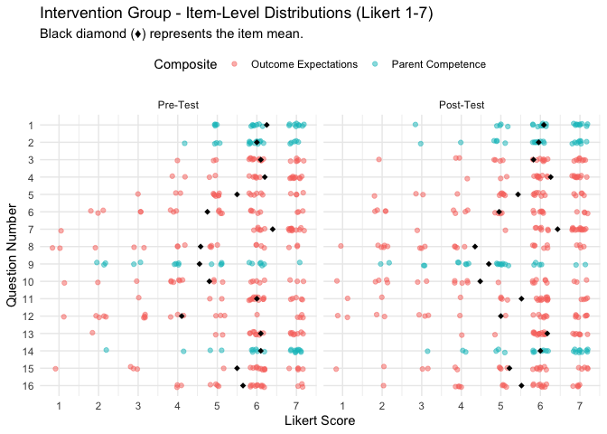
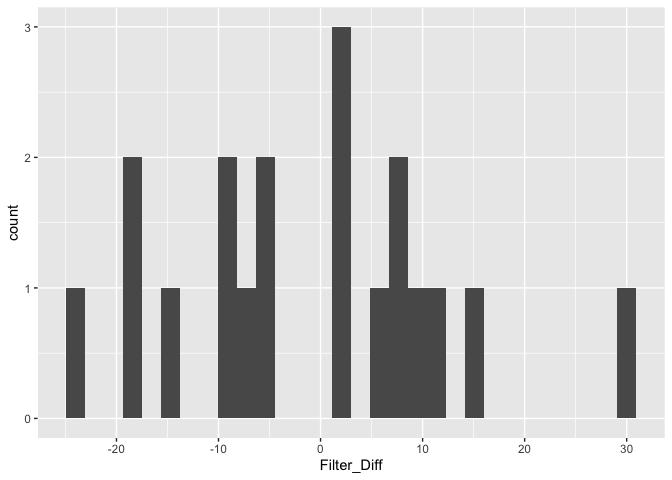
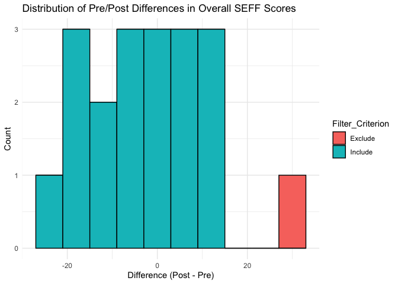
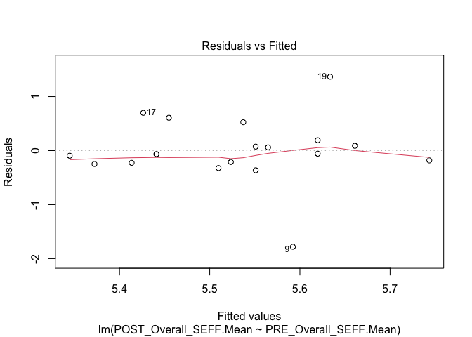
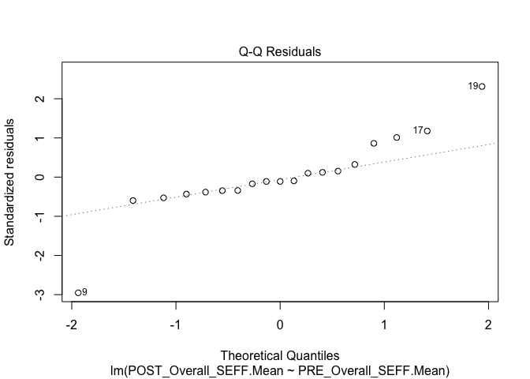
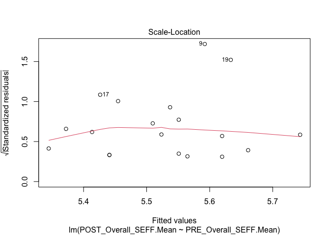
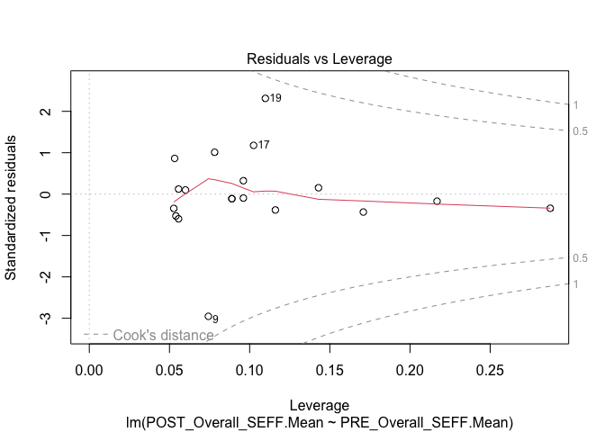
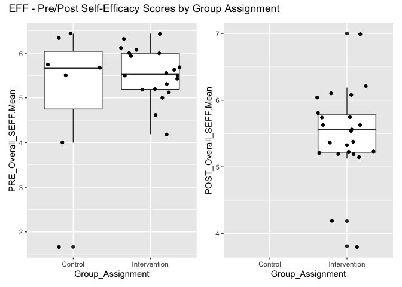
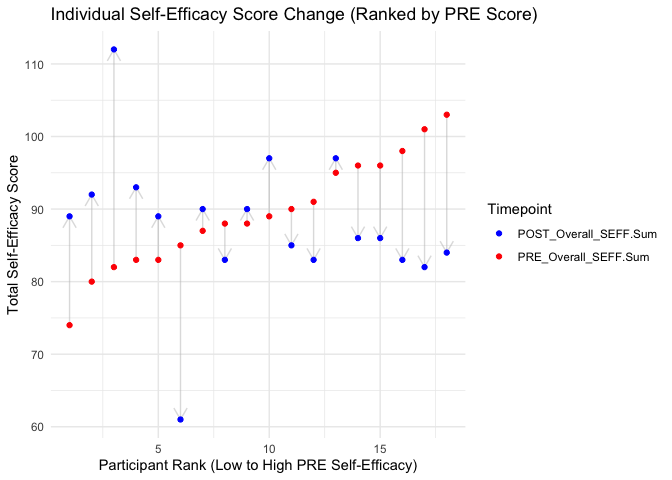
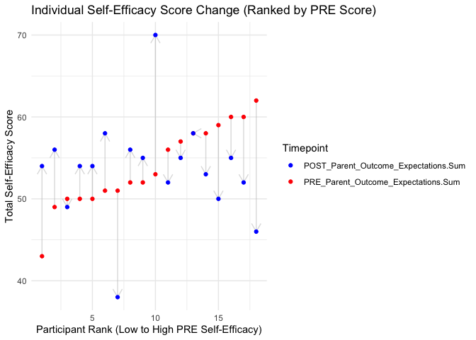

Updated_Analysis; Self-Efficacy (EIPSES)
================
2026-09-16

# 0. Setup & Data Ingestion

## 0.1 Libraries

``` r
library(dplyr)       # Data manipulation
library(stringr)     # String manipulation
library(tidyr)       # Data pivoting
library(readr)       # Reading data
library(kableExtra)  # HTML Table formatting
library(ggplot2)     # Visualizations
library(ggpubr)      # Publication-ready plots
library(rstatix)     # T-tests and effect sizes
library(broom)       # Tidy statistical outputs
library(forcats)     # Factor manipulation
library(effectsize)  # effect size & omega squared

#install.packages("skimr")
#install.packages("gtExtras") # testing: used for quick summaries and viz
```

## 0.2 Load Data

### 0.2.1 !! Updated Data File:

- **UPDATED DATA FILE** - SEFF_Updated…
  - Both Surveys are connected to a single participant ID (Pre and Post)
    and collated in one spreadsheet
  - Transformed to numeric, scored, and saved in
    [Autism_Doula_Study_data_ingestion.Rmd](SEFF_Updated_Data_File_08-2026.Rmd)
- **Structure**
  - Study_ID (Joined ID across pre and post, unique to participant)
  - Group Assignment (Control or Intervention)
  - Self-Efficacy Scale: **PSS** - *Perceived Self-Efficacy Scale* - 10
    Questions
  - SEFF Scale: **EFF** - *Early Intervention Parent Self Efficacy* - 14
    Questions
  - Columns as Pre –\> Post

## 0.3 Load Analaysis Tables

``` r
analytic.files <- read_rds("../_output/analytic_files_scored_surveys.Rds")

EFF.scored <- analytic.files$EFF.scored
PSS.scored <- analytic.files$PSS.Scored
```

``` r
# library(gtExtras)
# 
# 
# EFF.scored %>% 
#   mutate(StudyID = factor(StudyID), Group_Assignment = factor(Group_Assignment)) %>%  
#   select(StudyID, Group_Assignment, contains(c("Sum","Mean"))) %>% 
#   gt_plt_summary()
```

— OUTLINE — Descriptive and Participant Checks (Missing Data / NAs)
Basic Histo/Frequency Etc… Difference Scores Dot Plots

— Stats — Scale Validation

— Tests — Pre & Post

— Models — Pre/Post Linear Mixed Models Etc…

# 1. EFF

``` r
EFF.scored %>% select(StudyID, Group_Assignment, contains(c("Sum","Mean"))) %>%
  kable(caption="EFF - Calculated Columns") %>% 
  kable_styling(bootstrap_options = c("striped", "hover"), full_width = F) %>%    scroll_box(height = "400px", width = "100%")
```

<div style="border: 1px solid #ddd; padding: 0px; overflow-y: scroll; height:400px; overflow-x: scroll; width:100%; ">

<table class="table table-striped table-hover" style="color: black; width: auto !important; margin-left: auto; margin-right: auto;">

<caption>

EFF - Calculated Columns
</caption>

<thead>

<tr>

<th style="text-align:right;position: sticky; top:0; background-color: #FFFFFF;">

StudyID
</th>

<th style="text-align:left;position: sticky; top:0; background-color: #FFFFFF;">

Group_Assignment
</th>

<th style="text-align:right;position: sticky; top:0; background-color: #FFFFFF;">

PRE_Parent_Outcome_Expectations.Sum
</th>

<th style="text-align:right;position: sticky; top:0; background-color: #FFFFFF;">

PRE_Parent_Competence.Sum
</th>

<th style="text-align:right;position: sticky; top:0; background-color: #FFFFFF;">

PRE_Overall_SEFF.Sum
</th>

<th style="text-align:right;position: sticky; top:0; background-color: #FFFFFF;">

POST_Parent_Outcome_Expectations.Sum
</th>

<th style="text-align:right;position: sticky; top:0; background-color: #FFFFFF;">

POST_Parent_Competence.Sum
</th>

<th style="text-align:right;position: sticky; top:0; background-color: #FFFFFF;">

POST_Overall_SEFF.Sum
</th>

<th style="text-align:right;position: sticky; top:0; background-color: #FFFFFF;">

PRE_Parent_Outcome_Expectations.Mean
</th>

<th style="text-align:right;position: sticky; top:0; background-color: #FFFFFF;">

PRE_Parent_Competence.Mean
</th>

<th style="text-align:right;position: sticky; top:0; background-color: #FFFFFF;">

PRE_Overall_SEFF.Mean
</th>

<th style="text-align:right;position: sticky; top:0; background-color: #FFFFFF;">

POST_Parent_Outcome_Expectations.Mean
</th>

<th style="text-align:right;position: sticky; top:0; background-color: #FFFFFF;">

POST_Parent_Competence.Mean
</th>

<th style="text-align:right;position: sticky; top:0; background-color: #FFFFFF;">

POST_Overall_SEFF.Mean
</th>

</tr>

</thead>

<tbody>

<tr>

<td style="text-align:right;">

1
</td>

<td style="text-align:left;">

Intervention
</td>

<td style="text-align:right;">

0
</td>

<td style="text-align:right;">

0
</td>

<td style="text-align:right;">

0
</td>

<td style="text-align:right;">

63
</td>

<td style="text-align:right;">

24
</td>

<td style="text-align:right;">

99
</td>

<td style="text-align:right;">

NaN
</td>

<td style="text-align:right;">

NaN
</td>

<td style="text-align:right;">

NaN
</td>

<td style="text-align:right;">

6.3
</td>

<td style="text-align:right;">

6.00
</td>

<td style="text-align:right;">

6.19
</td>

</tr>

<tr>

<td style="text-align:right;">

2
</td>

<td style="text-align:left;">

Intervention
</td>

<td style="text-align:right;">

43
</td>

<td style="text-align:right;">

19
</td>

<td style="text-align:right;">

67
</td>

<td style="text-align:right;">

0
</td>

<td style="text-align:right;">

0
</td>

<td style="text-align:right;">

0
</td>

<td style="text-align:right;">

4.30
</td>

<td style="text-align:right;">

4.75
</td>

<td style="text-align:right;">

4.19
</td>

<td style="text-align:right;">

NaN
</td>

<td style="text-align:right;">

NaN
</td>

<td style="text-align:right;">

NaN
</td>

</tr>

<tr>

<td style="text-align:right;">

3
</td>

<td style="text-align:left;">

Intervention
</td>

<td style="text-align:right;">

52
</td>

<td style="text-align:right;">

25
</td>

<td style="text-align:right;">

89
</td>

<td style="text-align:right;">

56
</td>

<td style="text-align:right;">

27
</td>

<td style="text-align:right;">

97
</td>

<td style="text-align:right;">

5.20
</td>

<td style="text-align:right;">

6.25
</td>

<td style="text-align:right;">

5.56
</td>

<td style="text-align:right;">

5.6
</td>

<td style="text-align:right;">

6.75
</td>

<td style="text-align:right;">

6.06
</td>

</tr>

<tr>

<td style="text-align:right;">

4
</td>

<td style="text-align:left;">

Control
</td>

<td style="text-align:right;">

4
</td>

<td style="text-align:right;">

1
</td>

<td style="text-align:right;">

5
</td>

<td style="text-align:right;">

0
</td>

<td style="text-align:right;">

0
</td>

<td style="text-align:right;">

0
</td>

<td style="text-align:right;">

2.00
</td>

<td style="text-align:right;">

1.00
</td>

<td style="text-align:right;">

1.67
</td>

<td style="text-align:right;">

NaN
</td>

<td style="text-align:right;">

NaN
</td>

<td style="text-align:right;">

NaN
</td>

</tr>

<tr>

<td style="text-align:right;">

6
</td>

<td style="text-align:left;">

Intervention
</td>

<td style="text-align:right;">

51
</td>

<td style="text-align:right;">

23
</td>

<td style="text-align:right;">

87
</td>

<td style="text-align:right;">

58
</td>

<td style="text-align:right;">

24
</td>

<td style="text-align:right;">

90
</td>

<td style="text-align:right;">

5.10
</td>

<td style="text-align:right;">

5.75
</td>

<td style="text-align:right;">

5.44
</td>

<td style="text-align:right;">

5.8
</td>

<td style="text-align:right;">

6.00
</td>

<td style="text-align:right;">

5.62
</td>

</tr>

<tr>

<td style="text-align:right;">

7
</td>

<td style="text-align:left;">

Control
</td>

<td style="text-align:right;">

5
</td>

<td style="text-align:right;">

7
</td>

<td style="text-align:right;">

12
</td>

<td style="text-align:right;">

0
</td>

<td style="text-align:right;">

0
</td>

<td style="text-align:right;">

0
</td>

<td style="text-align:right;">

2.50
</td>

<td style="text-align:right;">

7.00
</td>

<td style="text-align:right;">

4.00
</td>

<td style="text-align:right;">

NaN
</td>

<td style="text-align:right;">

NaN
</td>

<td style="text-align:right;">

NaN
</td>

</tr>

<tr>

<td style="text-align:right;">

8
</td>

<td style="text-align:left;">

Intervention
</td>

<td style="text-align:right;">

0
</td>

<td style="text-align:right;">

0
</td>

<td style="text-align:right;">

0
</td>

<td style="text-align:right;">

32
</td>

<td style="text-align:right;">

23
</td>

<td style="text-align:right;">

67
</td>

<td style="text-align:right;">

NaN
</td>

<td style="text-align:right;">

NaN
</td>

<td style="text-align:right;">

NaN
</td>

<td style="text-align:right;">

3.2
</td>

<td style="text-align:right;">

5.75
</td>

<td style="text-align:right;">

4.19
</td>

</tr>

<tr>

<td style="text-align:right;">

9
</td>

<td style="text-align:left;">

Control
</td>

<td style="text-align:right;">

13
</td>

<td style="text-align:right;">

6
</td>

<td style="text-align:right;">

19
</td>

<td style="text-align:right;">

0
</td>

<td style="text-align:right;">

0
</td>

<td style="text-align:right;">

0
</td>

<td style="text-align:right;">

6.50
</td>

<td style="text-align:right;">

6.00
</td>

<td style="text-align:right;">

6.33
</td>

<td style="text-align:right;">

NaN
</td>

<td style="text-align:right;">

NaN
</td>

<td style="text-align:right;">

NaN
</td>

</tr>

<tr>

<td style="text-align:right;">

10
</td>

<td style="text-align:left;">

Intervention
</td>

<td style="text-align:right;">

51
</td>

<td style="text-align:right;">

22
</td>

<td style="text-align:right;">

85
</td>

<td style="text-align:right;">

38
</td>

<td style="text-align:right;">

17
</td>

<td style="text-align:right;">

61
</td>

<td style="text-align:right;">

5.10
</td>

<td style="text-align:right;">

5.50
</td>

<td style="text-align:right;">

5.31
</td>

<td style="text-align:right;">

3.8
</td>

<td style="text-align:right;">

4.25
</td>

<td style="text-align:right;">

3.81
</td>

</tr>

<tr>

<td style="text-align:right;">

11
</td>

<td style="text-align:left;">

Control
</td>

<td style="text-align:right;">

56
</td>

<td style="text-align:right;">

24
</td>

<td style="text-align:right;">

92
</td>

<td style="text-align:right;">

0
</td>

<td style="text-align:right;">

0
</td>

<td style="text-align:right;">

0
</td>

<td style="text-align:right;">

5.60
</td>

<td style="text-align:right;">

6.00
</td>

<td style="text-align:right;">

5.75
</td>

<td style="text-align:right;">

NaN
</td>

<td style="text-align:right;">

NaN
</td>

<td style="text-align:right;">

NaN
</td>

</tr>

<tr>

<td style="text-align:right;">

12
</td>

<td style="text-align:left;">

Control
</td>

<td style="text-align:right;">

63
</td>

<td style="text-align:right;">

26
</td>

<td style="text-align:right;">

103
</td>

<td style="text-align:right;">

0
</td>

<td style="text-align:right;">

0
</td>

<td style="text-align:right;">

0
</td>

<td style="text-align:right;">

6.30
</td>

<td style="text-align:right;">

6.50
</td>

<td style="text-align:right;">

6.44
</td>

<td style="text-align:right;">

NaN
</td>

<td style="text-align:right;">

NaN
</td>

<td style="text-align:right;">

NaN
</td>

</tr>

<tr>

<td style="text-align:right;">

13
</td>

<td style="text-align:left;">

Control
</td>

<td style="text-align:right;">

49
</td>

<td style="text-align:right;">

25
</td>

<td style="text-align:right;">

88
</td>

<td style="text-align:right;">

0
</td>

<td style="text-align:right;">

0
</td>

<td style="text-align:right;">

0
</td>

<td style="text-align:right;">

4.90
</td>

<td style="text-align:right;">

6.25
</td>

<td style="text-align:right;">

5.50
</td>

<td style="text-align:right;">

NaN
</td>

<td style="text-align:right;">

NaN
</td>

<td style="text-align:right;">

NaN
</td>

</tr>

<tr>

<td style="text-align:right;">

14
</td>

<td style="text-align:left;">

Intervention
</td>

<td style="text-align:right;">

57
</td>

<td style="text-align:right;">

19
</td>

<td style="text-align:right;">

90
</td>

<td style="text-align:right;">

55
</td>

<td style="text-align:right;">

20
</td>

<td style="text-align:right;">

85
</td>

<td style="text-align:right;">

5.70
</td>

<td style="text-align:right;">

4.75
</td>

<td style="text-align:right;">

5.62
</td>

<td style="text-align:right;">

5.5
</td>

<td style="text-align:right;">

5.00
</td>

<td style="text-align:right;">

5.31
</td>

</tr>

<tr>

<td style="text-align:right;">

16
</td>

<td style="text-align:left;">

Intervention
</td>

<td style="text-align:right;">

50
</td>

<td style="text-align:right;">

25
</td>

<td style="text-align:right;">

88
</td>

<td style="text-align:right;">

49
</td>

<td style="text-align:right;">

22
</td>

<td style="text-align:right;">

83
</td>

<td style="text-align:right;">

5.00
</td>

<td style="text-align:right;">

6.25
</td>

<td style="text-align:right;">

5.50
</td>

<td style="text-align:right;">

4.9
</td>

<td style="text-align:right;">

5.50
</td>

<td style="text-align:right;">

5.19
</td>

</tr>

<tr>

<td style="text-align:right;">

17
</td>

<td style="text-align:left;">

Intervention
</td>

<td style="text-align:right;">

52
</td>

<td style="text-align:right;">

24
</td>

<td style="text-align:right;">

88
</td>

<td style="text-align:right;">

55
</td>

<td style="text-align:right;">

23
</td>

<td style="text-align:right;">

90
</td>

<td style="text-align:right;">

5.20
</td>

<td style="text-align:right;">

6.00
</td>

<td style="text-align:right;">

5.50
</td>

<td style="text-align:right;">

5.5
</td>

<td style="text-align:right;">

5.75
</td>

<td style="text-align:right;">

5.62
</td>

</tr>

<tr>

<td style="text-align:right;">

22
</td>

<td style="text-align:left;">

Intervention
</td>

<td style="text-align:right;">

62
</td>

<td style="text-align:right;">

27
</td>

<td style="text-align:right;">

103
</td>

<td style="text-align:right;">

46
</td>

<td style="text-align:right;">

26
</td>

<td style="text-align:right;">

84
</td>

<td style="text-align:right;">

6.20
</td>

<td style="text-align:right;">

6.75
</td>

<td style="text-align:right;">

6.44
</td>

<td style="text-align:right;">

4.6
</td>

<td style="text-align:right;">

6.50
</td>

<td style="text-align:right;">

5.25
</td>

</tr>

<tr>

<td style="text-align:right;">

26
</td>

<td style="text-align:left;">

Intervention
</td>

<td style="text-align:right;">

53
</td>

<td style="text-align:right;">

25
</td>

<td style="text-align:right;">

91
</td>

<td style="text-align:right;">

60
</td>

<td style="text-align:right;">

24
</td>

<td style="text-align:right;">

98
</td>

<td style="text-align:right;">

5.89
</td>

<td style="text-align:right;">

6.25
</td>

<td style="text-align:right;">

6.07
</td>

<td style="text-align:right;">

6.0
</td>

<td style="text-align:right;">

6.00
</td>

<td style="text-align:right;">

6.12
</td>

</tr>

<tr>

<td style="text-align:right;">

28
</td>

<td style="text-align:left;">

Intervention
</td>

<td style="text-align:right;">

59
</td>

<td style="text-align:right;">

26
</td>

<td style="text-align:right;">

96
</td>

<td style="text-align:right;">

50
</td>

<td style="text-align:right;">

24
</td>

<td style="text-align:right;">

86
</td>

<td style="text-align:right;">

5.90
</td>

<td style="text-align:right;">

6.50
</td>

<td style="text-align:right;">

6.00
</td>

<td style="text-align:right;">

5.0
</td>

<td style="text-align:right;">

6.00
</td>

<td style="text-align:right;">

5.38
</td>

</tr>

<tr>

<td style="text-align:right;">

32
</td>

<td style="text-align:left;">

Intervention
</td>

<td style="text-align:right;">

53
</td>

<td style="text-align:right;">

17
</td>

<td style="text-align:right;">

82
</td>

<td style="text-align:right;">

70
</td>

<td style="text-align:right;">

28
</td>

<td style="text-align:right;">

112
</td>

<td style="text-align:right;">

5.30
</td>

<td style="text-align:right;">

4.25
</td>

<td style="text-align:right;">

5.12
</td>

<td style="text-align:right;">

7.0
</td>

<td style="text-align:right;">

7.00
</td>

<td style="text-align:right;">

7.00
</td>

</tr>

<tr>

<td style="text-align:right;">

39
</td>

<td style="text-align:left;">

Intervention
</td>

<td style="text-align:right;">

49
</td>

<td style="text-align:right;">

20
</td>

<td style="text-align:right;">

80
</td>

<td style="text-align:right;">

56
</td>

<td style="text-align:right;">

25
</td>

<td style="text-align:right;">

92
</td>

<td style="text-align:right;">

4.90
</td>

<td style="text-align:right;">

5.00
</td>

<td style="text-align:right;">

5.00
</td>

<td style="text-align:right;">

5.6
</td>

<td style="text-align:right;">

6.25
</td>

<td style="text-align:right;">

5.75
</td>

</tr>

<tr>

<td style="text-align:right;">

40
</td>

<td style="text-align:left;">

Intervention
</td>

<td style="text-align:right;">

0
</td>

<td style="text-align:right;">

0
</td>

<td style="text-align:right;">

0
</td>

<td style="text-align:right;">

54
</td>

<td style="text-align:right;">

18
</td>

<td style="text-align:right;">

84
</td>

<td style="text-align:right;">

NaN
</td>

<td style="text-align:right;">

NaN
</td>

<td style="text-align:right;">

NaN
</td>

<td style="text-align:right;">

5.4
</td>

<td style="text-align:right;">

4.50
</td>

<td style="text-align:right;">

5.25
</td>

</tr>

<tr>

<td style="text-align:right;">

42
</td>

<td style="text-align:left;">

Intervention
</td>

<td style="text-align:right;">

58
</td>

<td style="text-align:right;">

24
</td>

<td style="text-align:right;">

95
</td>

<td style="text-align:right;">

58
</td>

<td style="text-align:right;">

27
</td>

<td style="text-align:right;">

97
</td>

<td style="text-align:right;">

5.80
</td>

<td style="text-align:right;">

6.00
</td>

<td style="text-align:right;">

5.94
</td>

<td style="text-align:right;">

5.8
</td>

<td style="text-align:right;">

6.75
</td>

<td style="text-align:right;">

6.06
</td>

</tr>

<tr>

<td style="text-align:right;">

44
</td>

<td style="text-align:left;">

Intervention
</td>

<td style="text-align:right;">

50
</td>

<td style="text-align:right;">

21
</td>

<td style="text-align:right;">

83
</td>

<td style="text-align:right;">

54
</td>

<td style="text-align:right;">

26
</td>

<td style="text-align:right;">

93
</td>

<td style="text-align:right;">

5.00
</td>

<td style="text-align:right;">

5.25
</td>

<td style="text-align:right;">

5.19
</td>

<td style="text-align:right;">

5.4
</td>

<td style="text-align:right;">

6.50
</td>

<td style="text-align:right;">

5.81
</td>

</tr>

<tr>

<td style="text-align:right;">

45
</td>

<td style="text-align:left;">

Intervention
</td>

<td style="text-align:right;">

58
</td>

<td style="text-align:right;">

26
</td>

<td style="text-align:right;">

98
</td>

<td style="text-align:right;">

53
</td>

<td style="text-align:right;">

19
</td>

<td style="text-align:right;">

83
</td>

<td style="text-align:right;">

5.80
</td>

<td style="text-align:right;">

6.50
</td>

<td style="text-align:right;">

6.12
</td>

<td style="text-align:right;">

5.3
</td>

<td style="text-align:right;">

4.75
</td>

<td style="text-align:right;">

5.19
</td>

</tr>

<tr>

<td style="text-align:right;">

50
</td>

<td style="text-align:left;">

Intervention
</td>

<td style="text-align:right;">

0
</td>

<td style="text-align:right;">

0
</td>

<td style="text-align:right;">

0
</td>

<td style="text-align:right;">

56
</td>

<td style="text-align:right;">

23
</td>

<td style="text-align:right;">

92
</td>

<td style="text-align:right;">

NaN
</td>

<td style="text-align:right;">

NaN
</td>

<td style="text-align:right;">

NaN
</td>

<td style="text-align:right;">

5.6
</td>

<td style="text-align:right;">

5.75
</td>

<td style="text-align:right;">

5.75
</td>

</tr>

<tr>

<td style="text-align:right;">

51
</td>

<td style="text-align:left;">

Intervention
</td>

<td style="text-align:right;">

43
</td>

<td style="text-align:right;">

19
</td>

<td style="text-align:right;">

74
</td>

<td style="text-align:right;">

54
</td>

<td style="text-align:right;">

22
</td>

<td style="text-align:right;">

89
</td>

<td style="text-align:right;">

4.30
</td>

<td style="text-align:right;">

4.75
</td>

<td style="text-align:right;">

4.62
</td>

<td style="text-align:right;">

5.4
</td>

<td style="text-align:right;">

5.50
</td>

<td style="text-align:right;">

5.56
</td>

</tr>

<tr>

<td style="text-align:right;">

53
</td>

<td style="text-align:left;">

Intervention
</td>

<td style="text-align:right;">

60
</td>

<td style="text-align:right;">

25
</td>

<td style="text-align:right;">

96
</td>

<td style="text-align:right;">

55
</td>

<td style="text-align:right;">

21
</td>

<td style="text-align:right;">

86
</td>

<td style="text-align:right;">

6.00
</td>

<td style="text-align:right;">

6.25
</td>

<td style="text-align:right;">

6.00
</td>

<td style="text-align:right;">

5.5
</td>

<td style="text-align:right;">

5.25
</td>

<td style="text-align:right;">

5.38
</td>

</tr>

<tr>

<td style="text-align:right;">

56
</td>

<td style="text-align:left;">

Intervention
</td>

<td style="text-align:right;">

60
</td>

<td style="text-align:right;">

28
</td>

<td style="text-align:right;">

101
</td>

<td style="text-align:right;">

52
</td>

<td style="text-align:right;">

19
</td>

<td style="text-align:right;">

82
</td>

<td style="text-align:right;">

6.00
</td>

<td style="text-align:right;">

7.00
</td>

<td style="text-align:right;">

6.31
</td>

<td style="text-align:right;">

5.2
</td>

<td style="text-align:right;">

4.75
</td>

<td style="text-align:right;">

5.12
</td>

</tr>

<tr>

<td style="text-align:right;">

58
</td>

<td style="text-align:left;">

Intervention
</td>

<td style="text-align:right;">

56
</td>

<td style="text-align:right;">

23
</td>

<td style="text-align:right;">

91
</td>

<td style="text-align:right;">

52
</td>

<td style="text-align:right;">

18
</td>

<td style="text-align:right;">

83
</td>

<td style="text-align:right;">

5.60
</td>

<td style="text-align:right;">

5.75
</td>

<td style="text-align:right;">

5.69
</td>

<td style="text-align:right;">

5.2
</td>

<td style="text-align:right;">

4.50
</td>

<td style="text-align:right;">

5.19
</td>

</tr>

<tr>

<td style="text-align:right;">

59
</td>

<td style="text-align:left;">

Intervention
</td>

<td style="text-align:right;">

50
</td>

<td style="text-align:right;">

20
</td>

<td style="text-align:right;">

83
</td>

<td style="text-align:right;">

54
</td>

<td style="text-align:right;">

23
</td>

<td style="text-align:right;">

89
</td>

<td style="text-align:right;">

5.00
</td>

<td style="text-align:right;">

5.00
</td>

<td style="text-align:right;">

5.19
</td>

<td style="text-align:right;">

5.4
</td>

<td style="text-align:right;">

5.75
</td>

<td style="text-align:right;">

5.56
</td>

</tr>

<tr>

<td style="text-align:right;">

60
</td>

<td style="text-align:left;">

Control
</td>

<td style="text-align:right;">

10
</td>

<td style="text-align:right;">

7
</td>

<td style="text-align:right;">

17
</td>

<td style="text-align:right;">

0
</td>

<td style="text-align:right;">

0
</td>

<td style="text-align:right;">

0
</td>

<td style="text-align:right;">

5.00
</td>

<td style="text-align:right;">

7.00
</td>

<td style="text-align:right;">

5.67
</td>

<td style="text-align:right;">

NaN
</td>

<td style="text-align:right;">

NaN
</td>

<td style="text-align:right;">

NaN
</td>

</tr>

</tbody>

</table>

</div>

## 1.1 Descriptive Table

``` r
library(tableone)
EFF.t1 <- 
  EFF.scored %>% 
tableone::CreateTableOne(
  vars = c("PRE_Overall_SEFF.Mean", "POST_Overall_SEFF.Mean","PRE_Parent_Outcome_Expectations.Mean", "POST_Parent_Outcome_Expectations.Mean","PRE_Parent_Competence.Mean", "POST_Parent_Competence.Mean"),
  strata = "Group_Assignment",
  factorVars = c("Group_Assignment"),
  testNormal = "oneway.test"
) 
EFF.t1 %>%   print(showAllLevels = TRUE, quote = FALSE, noSpaces = TRUE) %>% 
  kable(caption="EFF - Descriptive Table") %>% 
  kable_styling(bootstrap_options = c("striped", "hover"), full_width = F) %>%    scroll_box(height = "400px", width = "100%")
```

    ##                                                    Stratified by Group_Assignment
    ##                                                     level Control    
    ##   n                                                       7          
    ##   PRE_Overall_SEFF.Mean (mean (SD))                       5.05 (1.69)
    ##   POST_Overall_SEFF.Mean (mean (SD))                      NaN (NA)   
    ##   PRE_Parent_Outcome_Expectations.Mean (mean (SD))        4.69 (1.77)
    ##   POST_Parent_Outcome_Expectations.Mean (mean (SD))       NaN (NA)   
    ##   PRE_Parent_Competence.Mean (mean (SD))                  5.68 (2.11)
    ##   POST_Parent_Competence.Mean (mean (SD))                 NaN (NA)   
    ##                                                    Stratified by Group_Assignment
    ##                                                     Intervention p     test
    ##   n                                                 24                     
    ##   PRE_Overall_SEFF.Mean (mean (SD))                 5.54 (0.57)  0.258     
    ##   POST_Overall_SEFF.Mean (mean (SD))                5.49 (0.65)  NA        
    ##   PRE_Parent_Outcome_Expectations.Mean (mean (SD))  5.36 (0.55)  0.132     
    ##   POST_Parent_Outcome_Expectations.Mean (mean (SD)) 5.35 (0.76)  NA        
    ##   PRE_Parent_Competence.Mean (mean (SD))            5.72 (0.78)  0.932     
    ##   POST_Parent_Competence.Mean (mean (SD))           5.68 (0.78)  NA

<div style="border: 1px solid #ddd; padding: 0px; overflow-y: scroll; height:400px; overflow-x: scroll; width:100%; ">

<table class="table table-striped table-hover" style="color: black; width: auto !important; margin-left: auto; margin-right: auto;">

<caption>

EFF - Descriptive Table
</caption>

<thead>

<tr>

<th style="text-align:left;position: sticky; top:0; background-color: #FFFFFF;">

</th>

<th style="text-align:left;position: sticky; top:0; background-color: #FFFFFF;">

level
</th>

<th style="text-align:left;position: sticky; top:0; background-color: #FFFFFF;">

Control
</th>

<th style="text-align:left;position: sticky; top:0; background-color: #FFFFFF;">

Intervention
</th>

<th style="text-align:left;position: sticky; top:0; background-color: #FFFFFF;">

p
</th>

<th style="text-align:left;position: sticky; top:0; background-color: #FFFFFF;">

test
</th>

</tr>

</thead>

<tbody>

<tr>

<td style="text-align:left;">

n
</td>

<td style="text-align:left;">

</td>

<td style="text-align:left;">

7
</td>

<td style="text-align:left;">

24
</td>

<td style="text-align:left;">

</td>

<td style="text-align:left;">

</td>

</tr>

<tr>

<td style="text-align:left;">

PRE_Overall_SEFF.Mean (mean (SD))
</td>

<td style="text-align:left;">

</td>

<td style="text-align:left;">

5.05 (1.69)
</td>

<td style="text-align:left;">

5.54 (0.57)
</td>

<td style="text-align:left;">

0.258
</td>

<td style="text-align:left;">

</td>

</tr>

<tr>

<td style="text-align:left;">

POST_Overall_SEFF.Mean (mean (SD))
</td>

<td style="text-align:left;">

</td>

<td style="text-align:left;">

NaN (NA)
</td>

<td style="text-align:left;">

5.49 (0.65)
</td>

<td style="text-align:left;">

NA
</td>

<td style="text-align:left;">

</td>

</tr>

<tr>

<td style="text-align:left;">

PRE_Parent_Outcome_Expectations.Mean (mean (SD))
</td>

<td style="text-align:left;">

</td>

<td style="text-align:left;">

4.69 (1.77)
</td>

<td style="text-align:left;">

5.36 (0.55)
</td>

<td style="text-align:left;">

0.132
</td>

<td style="text-align:left;">

</td>

</tr>

<tr>

<td style="text-align:left;">

POST_Parent_Outcome_Expectations.Mean (mean (SD))
</td>

<td style="text-align:left;">

</td>

<td style="text-align:left;">

NaN (NA)
</td>

<td style="text-align:left;">

5.35 (0.76)
</td>

<td style="text-align:left;">

NA
</td>

<td style="text-align:left;">

</td>

</tr>

<tr>

<td style="text-align:left;">

PRE_Parent_Competence.Mean (mean (SD))
</td>

<td style="text-align:left;">

</td>

<td style="text-align:left;">

5.68 (2.11)
</td>

<td style="text-align:left;">

5.72 (0.78)
</td>

<td style="text-align:left;">

0.932
</td>

<td style="text-align:left;">

</td>

</tr>

<tr>

<td style="text-align:left;">

POST_Parent_Competence.Mean (mean (SD))
</td>

<td style="text-align:left;">

</td>

<td style="text-align:left;">

NaN (NA)
</td>

<td style="text-align:left;">

5.68 (0.78)
</td>

<td style="text-align:left;">

NA
</td>

<td style="text-align:left;">

</td>

</tr>

</tbody>

</table>

</div>

``` r
EFF.long <- EFF.scored %>%
  select(StudyID, Group_Assignment, ends_with(c(".Sum",".Mean"))) %>%
  pivot_longer(cols = ends_with(c(".Sum",".Mean")), names_to = "Variable", values_to = "Score") %>%
  separate(Variable, into = c("Condition", "Composite_Type"), sep = "_", extra = "merge") %>%
  separate(Composite_Type, into = c("Composite_Type", "Calculation"), sep = "\\.", extra = "merge")


EFF.int.desc <- 
  EFF.long %>% 
    filter(Group_Assignment == "Intervention") %>%
    filter(Calculation == "Mean") %>%
    group_by(Group_Assignment, Condition, Composite_Type) %>% 
    summarize(
    N = n(),
    Missing = sum(Score==0),
    Mean = mean(Score, na.rm=TRUE),
    SD = sd(Score, na.rm=TRUE),
    Min = min(Score, na.rm=TRUE),
    Max = max(Score, na.rm=TRUE),
    .groups = "drop"
  )

  
EFF.int.desc %>%
 kable(digits = 2,
       caption = "Summary Table - Group Means and St.Deviations") %>%
 kable_styling(full_width = F)
```

<table class="table" style="color: black; width: auto !important; margin-left: auto; margin-right: auto;">

<caption>

Summary Table - Group Means and St.Deviations
</caption>

<thead>

<tr>

<th style="text-align:left;">

Group_Assignment
</th>

<th style="text-align:left;">

Condition
</th>

<th style="text-align:left;">

Composite_Type
</th>

<th style="text-align:right;">

N
</th>

<th style="text-align:right;">

Missing
</th>

<th style="text-align:right;">

Mean
</th>

<th style="text-align:right;">

SD
</th>

<th style="text-align:right;">

Min
</th>

<th style="text-align:right;">

Max
</th>

</tr>

</thead>

<tbody>

<tr>

<td style="text-align:left;">

Intervention
</td>

<td style="text-align:left;">

POST
</td>

<td style="text-align:left;">

Overall_SEFF
</td>

<td style="text-align:right;">

24
</td>

<td style="text-align:right;">

NA
</td>

<td style="text-align:right;">

5.49
</td>

<td style="text-align:right;">

0.65
</td>

<td style="text-align:right;">

3.81
</td>

<td style="text-align:right;">

7.00
</td>

</tr>

<tr>

<td style="text-align:left;">

Intervention
</td>

<td style="text-align:left;">

POST
</td>

<td style="text-align:left;">

Parent_Competence
</td>

<td style="text-align:right;">

24
</td>

<td style="text-align:right;">

NA
</td>

<td style="text-align:right;">

5.68
</td>

<td style="text-align:right;">

0.78
</td>

<td style="text-align:right;">

4.25
</td>

<td style="text-align:right;">

7.00
</td>

</tr>

<tr>

<td style="text-align:left;">

Intervention
</td>

<td style="text-align:left;">

POST
</td>

<td style="text-align:left;">

Parent_Outcome_Expectations
</td>

<td style="text-align:right;">

24
</td>

<td style="text-align:right;">

NA
</td>

<td style="text-align:right;">

5.35
</td>

<td style="text-align:right;">

0.76
</td>

<td style="text-align:right;">

3.20
</td>

<td style="text-align:right;">

7.00
</td>

</tr>

<tr>

<td style="text-align:left;">

Intervention
</td>

<td style="text-align:left;">

PRE
</td>

<td style="text-align:left;">

Overall_SEFF
</td>

<td style="text-align:right;">

24
</td>

<td style="text-align:right;">

NA
</td>

<td style="text-align:right;">

5.54
</td>

<td style="text-align:right;">

0.57
</td>

<td style="text-align:right;">

4.19
</td>

<td style="text-align:right;">

6.44
</td>

</tr>

<tr>

<td style="text-align:left;">

Intervention
</td>

<td style="text-align:left;">

PRE
</td>

<td style="text-align:left;">

Parent_Competence
</td>

<td style="text-align:right;">

24
</td>

<td style="text-align:right;">

NA
</td>

<td style="text-align:right;">

5.72
</td>

<td style="text-align:right;">

0.78
</td>

<td style="text-align:right;">

4.25
</td>

<td style="text-align:right;">

7.00
</td>

</tr>

<tr>

<td style="text-align:left;">

Intervention
</td>

<td style="text-align:left;">

PRE
</td>

<td style="text-align:left;">

Parent_Outcome_Expectations
</td>

<td style="text-align:right;">

24
</td>

<td style="text-align:right;">

NA
</td>

<td style="text-align:right;">

5.36
</td>

<td style="text-align:right;">

0.55
</td>

<td style="text-align:right;">

4.30
</td>

<td style="text-align:right;">

6.20
</td>

</tr>

</tbody>

</table>

## 1.2 Norm Table from EFF Original Study Paper

- Excerpted Rows from Guimond et al. 2008
- Using **Mean** Scores (Means for Demographic Groups)
- Grouped by Child demographic, Parents are still the survey subject.

| Group | N | Total EIPSES (M, SD) | Parent Outcome Expectations (M, SD) | Parent Competence (M, SD) |
|----|----|----|----|----|
| Child gender<br>Boys | 72 | 5.75 (.64) | 5.68 (.79) | 5.90 (.79) |
| Child gender<br>Girls | 45 | 5.94 (.65) | 5.91 (.73) | 6.02 (.73) |
| Ethnicity<br>White | 77 | 5.92 (.59) | 5.93 (.64) | 5.89 (.74) |
| Ethnicity<br>Hispanic | 27 | 5.65 (.79) | 5.44 (1.03) | 6.07 (.74) |
| Ethnicity<br>Other | 13 | 5.65 (.55) | 5.51 (.64) | 6.02 (.69) |
| Child disorder severity<br>Mild | 46 | 5.97 (.63) | 5.92 (.75) | 6.11 (.70) |
| Child disorder severity<br>Modereate | 44 | 5.76 (.64) | 5.71 (.75) | 5.89 (.79) |
| Child disorder severity<br>Severe | 11 | 6.05 (.54) | 6.05 (.56) | 6.05 (.76) |

## 1.2 EFF - Scale Validation

## 2. Test Internal Consistency (Cronbach’s Alpha)

- Here we will calculate Cronbach’s alpha for each scale to check for
  internal consistency.
- A general rule of thumb is that an alpha of \> 0.7 is acceptable.
- **PRE Group** is just under .7 ~ should check for
  consistency/outliers.

``` r
pre_alpha <- 
  EFF.scored %>% 
  filter(Group_Assignment == "Intervention") %>% 
  select(contains("EFF.PRE_Q")) %>% 
  psych::alpha()
```

    ## Some items ( EFF.PRE_Q7 EFF.PRE_Q8 ) were negatively correlated with the first principal component and 
    ## probably should be reversed.  
    ## To do this, run the function again with the 'check.keys=TRUE' option

``` r
post_alpha <- 
  EFF.scored %>% 
  filter(Group_Assignment == "Intervention") %>% 
  select(contains("EFF.POST_Q")) %>% 
  psych::alpha()
```

    ## Some items ( EFF.POST_Q5 EFF.POST_Q10 ) were negatively correlated with the first principal component and 
    ## probably should be reversed.  
    ## To do this, run the function again with the 'check.keys=TRUE' option

``` r
## Dataframe of the Cronbach Alpha Tests and Values
alpha_values <- data.frame(
  Scale = c("PRE", "POST"),
  Cronbach_Alpha = c(pre_alpha$total$raw_alpha,
                     post_alpha$total$raw_alpha)
)

alpha_values %>% 
  kableExtra::kable(digits=3,
                    caption = "Intervention Group: Cronbach Alpha Values") %>%
  kableExtra::kable_styling(bootstrap_options = c("striped", "hover", "condensed"), 
                            full_width = F)
```

<table class="table table-striped table-hover table-condensed" style="color: black; width: auto !important; margin-left: auto; margin-right: auto;">

<caption>

Intervention Group: Cronbach Alpha Values
</caption>

<thead>

<tr>

<th style="text-align:left;">

Scale
</th>

<th style="text-align:right;">

Cronbach_Alpha
</th>

</tr>

</thead>

<tbody>

<tr>

<td style="text-align:left;">

PRE
</td>

<td style="text-align:right;">

0.686
</td>

</tr>

<tr>

<td style="text-align:left;">

POST
</td>

<td style="text-align:right;">

0.744
</td>

</tr>

</tbody>

</table>

### 1.2 Item-Level Distribution (Dot Plot)

``` r
EFF.scored %>% 
  filter(Group_Assignment == "Intervention") %>% 
pivot_longer(cols = contains("_Q"), names_to = "Item", values_to = "Value") %>% 
  mutate(
    Condition = if_else(str_detect(Item, "PRE_"), "Pre-Test", "Post-Test"),
    Condition = factor(Condition, levels = c("Pre-Test", "Post-Test")),
    Q_Num = as.numeric(str_extract(Item, "\\d+")),
    Q_Order = factor(Q_Num, levels = 1:16),
    Composite = if_else(Q_Num %in% c(1, 2, 9, 14), "Parent Competence", "Outcome Expectations")
  ) %>% 
  filter(!is.na(Value)) %>% 
  ggplot(aes(x = Value, y = fct_rev(Q_Order), color = Composite)) +
  geom_jitter(position = position_jitter(width = 0.2, height = 0.1), alpha = 0.5) +
  stat_summary(fun = "mean", geom = "point", color = "black", size = 2, shape = 18) +
  facet_wrap(~Condition) +
  scale_x_continuous(breaks = 1:7) +
  theme_minimal() +
  theme(legend.position = "top") +
  labs(
    title = "Intervention Group - Item-Level Distributions (Likert 1-7)",
    subtitle = "Black diamond (♦) represents the item mean.",
    y = "Question Number",
    x = "Likert Score"
  )
```

<!-- -->

\#2. Descriptive Statistics

## 2.1 Descriptive Table

``` r
EFF.scored %>%
  summarise(.by = Group_Assignment, 
            N = n(),
            Mean_PRE = mean(PRE_Overall_SEFF.Sum, na.rm = TRUE),
            SD_PRE = sd(PRE_Overall_SEFF.Sum, na.rm = TRUE),
            Mean_POST = mean(POST_Overall_SEFF.Sum, na.rm = TRUE),
            SD_POST = sd(POST_Overall_SEFF.Sum, na.rm = TRUE)
            ) %>%
  kable(digits = 2,
        caption = "Summary Table - Group Totals and St.Deviations") %>%
  kable_styling(full_width = F)
```

<table class="table" style="color: black; width: auto !important; margin-left: auto; margin-right: auto;">

<caption>

Summary Table - Group Totals and St.Deviations
</caption>

<thead>

<tr>

<th style="text-align:left;">

Group_Assignment
</th>

<th style="text-align:right;">

N
</th>

<th style="text-align:right;">

Mean_PRE
</th>

<th style="text-align:right;">

SD_PRE
</th>

<th style="text-align:right;">

Mean_POST
</th>

<th style="text-align:right;">

SD_POST
</th>

</tr>

</thead>

<tbody>

<tr>

<td style="text-align:left;">

Intervention
</td>

<td style="text-align:right;">

24
</td>

<td style="text-align:right;">

73.6
</td>

<td style="text-align:right;">

34.6
</td>

<td style="text-align:right;">

84.2
</td>

<td style="text-align:right;">

20.6
</td>

</tr>

<tr>

<td style="text-align:left;">

Control
</td>

<td style="text-align:right;">

7
</td>

<td style="text-align:right;">

48.0
</td>

<td style="text-align:right;">

43.8
</td>

<td style="text-align:right;">

0.0
</td>

<td style="text-align:right;">

0.0
</td>

</tr>

</tbody>

</table>

### 2.2 Outlier Identification

``` r
EFF.check <- EFF.scored %>% 
  mutate(
    across(contains(c(".Sum", ".Mean")), ~ifelse(.==0, NA, .)), 
    Filter_Diff = POST_Overall_SEFF.Sum - PRE_Overall_SEFF.Sum,
    Filter_Diff = ifelse(Group_Assignment == "Control", NA, Filter_Diff)) %>% 
  rowwise() %>% 
  mutate(
    Complete = ifelse(any(is.na(c_across(contains("_Q")))), "Incomplete", "Complete")
  ) %>% 
  ungroup()

EFF.check %>% ggplot(aes(x=Filter_Diff))+ geom_histogram()
```

<!-- -->

``` r
library(magrittr)
EFF.check %>% select(contains(c(".Sum", ".Mean", "Complete")))
```

    ## # A tibble: 31 × 13
    ##    PRE_Parent_Outcome_Expectations…¹ PRE_Parent_Competenc…² PRE_Overall_SEFF.Sum
    ##                                <dbl>                  <dbl>                <dbl>
    ##  1                                NA                     NA                   NA
    ##  2                                43                     19                   67
    ##  3                                52                     25                   89
    ##  4                                 4                      1                    5
    ##  5                                51                     23                   87
    ##  6                                 5                      7                   12
    ##  7                                NA                     NA                   NA
    ##  8                                13                      6                   19
    ##  9                                51                     22                   85
    ## 10                                56                     24                   92
    ## # ℹ 21 more rows
    ## # ℹ abbreviated names: ¹​PRE_Parent_Outcome_Expectations.Sum,
    ## #   ²​PRE_Parent_Competence.Sum
    ## # ℹ 10 more variables: POST_Parent_Outcome_Expectations.Sum <dbl>,
    ## #   POST_Parent_Competence.Sum <dbl>, POST_Overall_SEFF.Sum <dbl>,
    ## #   PRE_Parent_Outcome_Expectations.Mean <dbl>,
    ## #   PRE_Parent_Competence.Mean <dbl>, PRE_Overall_SEFF.Mean <dbl>, …

``` r
#Control scores changed to NA and then ignored
f.mn <- mean(EFF.check$Filter_Diff[EFF.check$Complete == "Complete"], na.rm=TRUE)
f.sd <- sd(EFF.check$Filter_Diff, na.rm = TRUE)

EFF.check <- EFF.check %>% 
  mutate(
    Filter_Criterion = ifelse(Filter_Diff > (f.mn + 2*f.sd) | Filter_Diff < (f.mn - 2*f.sd), "Exclude", "Include")
  )

EFF.check %>% 
  filter(Group_Assignment == "Intervention") %>% 
  ggplot(aes(x=Filter_Diff, fill = Filter_Criterion)) + geom_histogram(bins=10, color="black") + 
  labs(title="Distribution of Pre/Post Differences in Overall SEFF Scores", x="Difference (Post - Pre)", y="Count") +
  theme_minimal()
```

<!-- -->

# 3. Statistical Tests

## 3.1 Equal Variances

- Standard assumption checks; given the small sample size, these aren’t
  too meaningful, especially as we are going to be running **pairwise**
  tests (same participants in the intervention group).
- Check the assumptions first: normality (shapiro_test()
- Paired Tests (Student test) equal variances (levene_test() /
  var.test()).
- If normality fails, switch to the Wilcoxon test, adjust variance,
  check outliers…

``` r
EFF.check %>% filter(Group_Assignment == "Intervention") %>% rstatix::shapiro_test(PRE_Overall_SEFF.Mean, POST_Overall_SEFF.Mean) %>% 
  mutate("Normality" = ifelse(p < 0.05, "Reject Null (Non-Normal)", "Fail to Reject Null (Normal)"))
```

    ## # A tibble: 2 × 4
    ##   variable               statistic      p Normality                   
    ##   <chr>                      <dbl>  <dbl> <chr>                       
    ## 1 POST_Overall_SEFF.Mean     0.921 0.0687 Fail to Reject Null (Normal)
    ## 2 PRE_Overall_SEFF.Mean      0.968 0.702  Fail to Reject Null (Normal)

``` r
EFF.check %>% 
  filter(Group_Assignment == "Control") %>% 
  rstatix::shapiro_test(PRE_Overall_SEFF.Mean) %>% 
  mutate("Normality" = ifelse(p < 0.05, "Reject Null (Non-Normal)", "Fail to Reject Null (Normal)"))
```

    ## # A tibble: 1 × 4
    ##   variable              statistic      p Normality               
    ##   <chr>                     <dbl>  <dbl> <chr>                   
    ## 1 PRE_Overall_SEFF.Mean     0.803 0.0435 Reject Null (Non-Normal)

``` r
EFF.check %>% rstatix::levene_test(PRE_Overall_SEFF.Mean ~ Group_Assignment) %>% 
  mutate("Equal Variance" = ifelse(p < 0.05, "Reject Null (Adjust Test)", "Fail to Reject Null (Standard Test)"))
```

    ## # A tibble: 1 × 5
    ##     df1   df2 statistic      p `Equal Variance`                   
    ##   <int> <int>     <dbl>  <dbl> <chr>                              
    ## 1     1    25      3.41 0.0767 Fail to Reject Null (Standard Test)

**fail to reject null; standard t-test is fine**

- Note: Can’t check against Controls here

``` r
# EFF.check %>% rstatix::levene_test(POST_Overall_SEFF.Mean ~ Group_Assignment) %>% 
#   mutate("Equal Variance" = ifelse(p < 0.05, "Reject Null (Adjust Test)", "Fail to Reject Null (Standard Test)"))
## reject null: use POOLED variance (or Welch's) ; likely to be the case given that Inervention POST was non-normal. 
```

# 3.3 Run Paired T-Tests

## Are the groups different initially?

``` r
EFF.check %>% 
  rstatix::t_test(PRE_Overall_SEFF.Mean ~ Group_Assignment, 
                  paired = FALSE, # Intervention v Control
                  alternative = "two.sided", #any difference 
                  conf.level = 0.1, 
                  var.equal = TRUE #levene reject null
                  ) %>% 
  mutate("Inference" = ifelse(p < 0.05, "Reject Null - Groups are diff", "Fail to Reject Null (groups same)"))
```

    ## # A tibble: 1 × 9
    ##   .y.                  group1 group2    n1    n2 statistic    df     p Inference
    ##   <chr>                <chr>  <chr>  <int> <int>     <dbl> <dbl> <dbl> <chr>    
    ## 1 PRE_Overall_SEFF.Me… Contr… Inter…     7    20     -1.16    25 0.258 Fail to …

- Not reading too much in yet as control sample is so small; (n=7).
- With no difference here, we will see if Pre –\> Post Intervention
  makes a difference *greater Efficacy*
- Compare Changes in intervention group.
- Compare Post Intervention to Control (if size allows…)
- `rstatix` used; mirrors the calculations for SPSS

## T-Test - Intervention Group, Pre v Post

``` r
EFF.long <- EFF.check %>%
  select(StudyID, Group_Assignment, Filter_Criterion, ends_with(c(".Sum",".Mean"))) %>%
  pivot_longer(cols = ends_with(c(".Sum",".Mean")), names_to = "Variable", values_to = "Score") %>%
  separate(Variable, into = c("Condition", "Composite_Type"), sep = "_", extra = "merge") %>%
  separate(Composite_Type, into = c("Composite_Type", "Calculation"), sep = "\\.", extra = "merge") %>% 
  mutate(Condition.f = factor(Condition, levels = c("PRE", "POST")))

library(rstatix)

# Run Paired T-Tests
t_test_results <- EFF.long %>%
  filter(Group_Assignment == "Intervention") %>% 
  filter(Calculation == "Mean") %>%
  group_by(Composite_Type) %>%
  rstatix::pairwise_t_test(Score ~ Condition.f, paired = TRUE, detailed = TRUE, conf.level = 0.1, alternative = "greater", pool.sd=TRUE)
  #adjust_pvalue(method = "holm") %>%
  #add_significance("p.adj")

t_test_results
```

    ## # A tibble: 3 × 16
    ##   Composite_Type  estimate .y.   group1 group2    n1    n2 statistic     p    df
    ## * <chr>              <dbl> <chr> <chr>  <chr>  <int> <int>     <dbl> <dbl> <dbl>
    ## 1 Overall_SEFF      0.0857 Score PRE    POST      20    23     0.442 0.332    18
    ## 2 Parent_Compete…   0.0526 Score PRE    POST      20    23     0.191 0.425    18
    ## 3 Parent_Outcome…   0.0257 Score PRE    POST      20    23     0.137 0.446    18
    ## # ℹ 6 more variables: conf.low <dbl>, conf.high <dbl>, method <chr>,
    ## #   alternative <chr>, p.adj <dbl>, p.adj.signif <chr>

## Wilcox Test

``` r
EFF.long %>% 
  filter(Group_Assignment == "Intervention") %>% 
  filter(Calculation == "Mean") %>%
  group_by(Composite_Type) %>% 
  rstatix::wilcox_test(Score ~ Condition.f, paired = TRUE, alternative = "greater", conf.level = 0.1)
```

    ## # A tibble: 3 × 8
    ##   Composite_Type              .y.   group1 group2    n1    n2 statistic     p
    ## * <chr>                       <chr> <chr>  <chr>  <int> <int>     <dbl> <dbl>
    ## 1 Overall_SEFF                Score PRE    POST      20    23     107   0.322
    ## 2 Parent_Competence           Score PRE    POST      20    23     101   0.412
    ## 3 Parent_Outcome_Expectations Score PRE    POST      20    23      88.5 0.457

## Interpretation

- Groups scores (Control & Intervention) are the same
  **PRE-INTERVENTION**
- Intervention Group scores do NOT significantly increase (from Pre to
  Post intervention)

``` r
# # Calculate Cohen's d for Effect Size
# cohens_d_results <- EFF.long %>%
#   filter(Group_Assignment == "Intervention") %>% 
#   filter(Calculation == "Mean") %>%
#   group_by(Composite_Type) %>%
#   rstatix::cohens_d(Score ~ Condition, paired = TRUE)
# 
# # Combine for final table
# t_test_final <- t_test_results %>%
#   left_join(select(cohens_d_results, Composite_Type, effsize, magnitude), by = "Composite_Type") %>%
#   select(Composite_Type, statistic, df, p, p.adj, p.adj.signif, effsize, magnitude)
# 
# t_test_final %>% 
#   kable(caption = "Paired T-Test Results (Mean: Pre vs. Post)", digits = 3) %>% 
#   kable_styling(bootstrap_options = c("striped", "hover"), full_width = T)
```

``` r
EFF.check %>% select(contains("Overall_SEFF.Mean")) %>% rstatix::cor_test(method = "kendall") 
```

    ## # A tibble: 1 × 6
    ##   var1                  var2                     cor statistic     p method 
    ##   <chr>                 <chr>                  <dbl>     <dbl> <dbl> <chr>  
    ## 1 PRE_Overall_SEFF.Mean POST_Overall_SEFF.Mean -0.23     -1.34 0.181 Kendall

``` r
lm(POST_Overall_SEFF.Mean ~ PRE_Overall_SEFF.Mean, data = EFF.check) %>% summary()
```

    ## 
    ## Call:
    ## lm(formula = POST_Overall_SEFF.Mean ~ PRE_Overall_SEFF.Mean, 
    ##     data = EFF.check)
    ## 
    ## Residuals:
    ##    Min     1Q Median     3Q    Max 
    ## -1.780 -0.218 -0.066  0.141  1.367 
    ## 
    ## Coefficients:
    ##                       Estimate Std. Error t value Pr(>|t|)   
    ## (Intercept)              6.761      1.732    3.90   0.0011 **
    ## PRE_Overall_SEFF.Mean   -0.220      0.307   -0.72   0.4840   
    ## ---
    ## Signif. codes:  0 '***' 0.001 '**' 0.01 '*' 0.05 '.' 0.1 ' ' 1
    ## 
    ## Residual standard error: 0.626 on 17 degrees of freedom
    ##   (12 observations deleted due to missingness)
    ## Multiple R-squared:  0.0292, Adjusted R-squared:  -0.0279 
    ## F-statistic: 0.512 on 1 and 17 DF,  p-value: 0.484

``` r
lm(POST_Overall_SEFF.Mean ~ PRE_Overall_SEFF.Mean, data = EFF.check) %>% plot()
```

<!-- --><!-- --><!-- --><!-- -->

``` r
## Does the intervention group change pre to post test?
# EFF.test.long <- EFF.check %>% 
#   filter(Filter_Criterion == "Include") %>%
#   filter(Group_Assignment == "Intervention") %>% 
#   select(StudyID, contains("Overall_SEFF.Mean")) %>%  
#   pivot_longer(cols = contains(c("Overall", "Parent")), names_to = "Composite", values_to = "Score") %>% 
#   mutate(
#     Timepoint = if_else(str_detect(Composite, "PRE_"), "Pre-Test", "Post-Test"),
#     Timepoint = factor(Timepoint, levels = c("Pre-Test", "Post-Test")),
#   )
# 
# EFF.test.long
# 
# # Run Paired T-Tests
# EFF.t_test_results <- EFF.test.long %>%
#   rstatix::pairwise_t_test(Score ~ Timepoint, paired = TRUE, detailed = TRUE, conf.level = 0.1, alternative = "greater", pool.sd=TRUE)
#   #adjust_pvalue(method = "holm") %>%
#   #add_significance("p.adj")
# 
# EFF.t_test_results
```

``` r
# EFF.check %>%
#   #filter(Filter_Criterion == "Include") %>%
#   filter(Group_Assignment == "Intervention") %>%
#   select(StudyID, contains(".Mean")) %>%
#   pivot_longer(cols = contains(c("Overall", "Parent")), names_to = "Composite", values_to = "Score") %>%
#   mutate(
#     Timepoint = if_else(str_detect(Composite, "PRE_"), "Pre-Test", "Post-Test"),
#     Timepoint = factor(Timepoint, levels = c("Pre-Test", "Post-Test")),
#   ) %>%
#   mutate(Composite_Type = str_replace_all(Composite, "_", " ")) %>% 
#   ggboxplot(
#     x = "Timepoint", y = "Score",
#     color = "Condition", palette = "jco",
#     add = "jitter",
#     facet.by = "Composite",
#     short.panel.labs = TRUE
#   ) +
#   labs(
#     title = "Composite Scores: Pre-Test vs. Post-Test",
#     x = "Timepoint",
#     y = "Mean Score"
#   ) +
#   theme_minimal() +
#   theme(legend.position = "none")
# 
# 
# # Run Paired T-Tests
# EFF.t_test_results <- EFF.test.long %>%
#   rstatix::pairwise_t_test(Score ~ Timepoint, paired = TRUE, detailed = TRUE, conf.level = 0.1, alternative = "greater", pool.sd=TRUE)
#   #adjust_pvalue(method = "holm") %>%
#   #add_significance("p.adj")
# 
# EFF.t_test_results
```

## One Sample Test (Against Control & Normed Mean)

- Normed Mean from EIPSES table, 5.47 (Race: Other)

``` r
EFF.check %>% 
  #filter(Filter_Criterion == "Include") %>%
  select(StudyID, Group_Assignment, POST_Overall_SEFF.Mean) %>%  
  filter(Group_Assignment == "Intervention") %>% 
  rstatix::t_test(POST_Overall_SEFF.Mean ~ 1, mu = 5.47) 
```

    ## # A tibble: 1 × 7
    ##   .y.                    group1 group2         n statistic    df     p
    ## * <chr>                  <chr>  <chr>      <int>     <dbl> <dbl> <dbl>
    ## 1 POST_Overall_SEFF.Mean 1      null model    23     0.182    22 0.857

- Post Self-Efficacy Sample is NOT significantly different from the
  normed (race group) or control.
- Indication that the intervention may have increase knowledge, but
  requires longer term work to demonstrate changes in efficacy, and may
  not be able to adequately account for **starting differences** (paired
  test)
- Especially given potential differences in Autism severity, and other
  factors noted as significantly different on the EIPSES paper.

# 4. Plots

## 4.0 Pre, Post and Control Boxplots

``` r
EFF.pre_boxplot <- 
  EFF.scored %>% 
  #select(StudyID, Group_Assignment, contains("Total"), contains("Mean")) %>% 
  ggplot(aes(x = Group_Assignment, y = PRE_Overall_SEFF.Mean))+
  geom_boxplot()+
  geom_jitter()

EFF.post_boxplot <- 
  EFF.scored %>% 
  #select(StudyID, Group_Assignment, contains("Total"), contains("Mean")) %>% 
  ggplot(aes(x = Group_Assignment, y = POST_Overall_SEFF.Mean))+
  geom_boxplot()+
  geom_jitter()

library(patchwork)

EFF.pre_boxplot + EFF.post_boxplot + plot_annotation(title = "EFF - Pre/Post Self-Efficacy Scores by Group Assignment")
```

<!-- -->

## 4.1 Change in Total Scores (Arrow Plot)

``` r
EFF.check %>% 
  filter(Group_Assignment == "Intervention",
         Complete == "Complete") %>% 
  arrange(PRE_Overall_SEFF.Sum) %>% 
  mutate(
    Rank_Order = seq_along(PRE_Overall_SEFF.Sum),
    Pct_Order = percent_rank(PRE_Overall_SEFF.Sum)
  ) %>% 
  ggplot(aes(x = Rank_Order)) +
  # 1. Add the arrows (vertical segments)
  geom_segment(aes(
    xend = Rank_Order, 
    y = PRE_Overall_SEFF.Sum, 
    yend = POST_Overall_SEFF.Sum
  ), 
  arrow = arrow(length = unit(.35, "cm")), # Adds the arrow head
  color = "gray", 
  alpha = 0.5) +
  
  # 2. Add the PRE points
  geom_point(aes(y = PRE_Overall_SEFF.Sum, color = "PRE_Overall_SEFF.Sum")) +
  
  # 3. Add the POST points
  geom_point(aes(y = POST_Overall_SEFF.Sum, color = "POST_Overall_SEFF.Sum")) +
  
  #4. Grouping...
  #facet_wrap(~Complete)+
  
  # Formatting
  scale_color_manual(values = c("PRE_Overall_SEFF.Sum" = "red", "POST_Overall_SEFF.Sum" = "blue")) +
  labs(
    title = "Individual Self-Efficacy Score Change (Ranked by PRE Score)",
    x = "Participant Rank (Low to High PRE Self-Efficacy)",
    y = "Total Self-Efficacy Score",
    color = "Timepoint"
  ) +
  theme_minimal()
```

<!-- -->

``` r
EFF.check %>% 
  filter(Group_Assignment == "Intervention",
         Complete == "Complete") %>% 
  arrange(PRE_Parent_Outcome_Expectations.Sum) %>% 
  mutate(
    Rank_Order = seq_along(PRE_Parent_Outcome_Expectations.Sum),
    Pct_Order = percent_rank(PRE_Parent_Outcome_Expectations.Sum)
  ) %>% 
  ggplot(aes(x = Rank_Order)) +
  # 1. Add the arrows (vertical segments)
  geom_segment(aes(
    xend = Rank_Order, 
    y = PRE_Parent_Outcome_Expectations.Sum, 
    yend = POST_Parent_Outcome_Expectations.Sum
  ), 
  arrow = arrow(length = unit(.35, "cm")), # Adds the arrow head
  color = "gray", 
  alpha = 0.5) +
  
  # 2. Add the PRE points
  geom_point(aes(y = PRE_Parent_Outcome_Expectations.Sum, color = "PRE_Parent_Outcome_Expectations.Sum")) +
  
  # 3. Add the POST points
  geom_point(aes(y = POST_Parent_Outcome_Expectations.Sum, color = "POST_Parent_Outcome_Expectations.Sum")) +
  
  #4. Grouping...
  #facet_wrap(~Complete)+
  
  # Formatting
  scale_color_manual(values = c("PRE_Parent_Outcome_Expectations.Sum" = "red", "POST_Parent_Outcome_Expectations.Sum" = "blue")) +
  labs(
    title = "Individual Self-Efficacy Score Change (Ranked by PRE Score)",
    x = "Participant Rank (Low to High PRE Self-Efficacy)",
    y = "Total Self-Efficacy Score",
    color = "Timepoint"
  ) +
  theme_minimal()
```

<!-- -->

### Interpretation

- This chart is interesting to me; because there seems to be an inverted
  effect, after sorting by rank.
- Participants that **STARTED** at low efficacy generally increased.
- Participants that **STARTED** at high efficacy, generally decreased.
- Inverse effect of gaining more knowledge?
- Could this be followed up on, by examining **qualitative interview**
  feedback
  - Suggests further interactive effects, maybe explorable via
    structural equation modeling.
